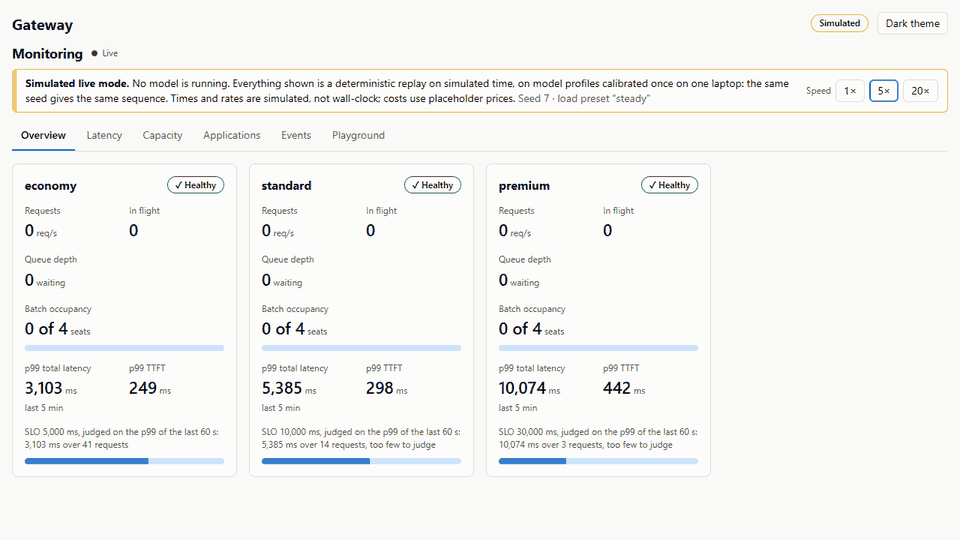
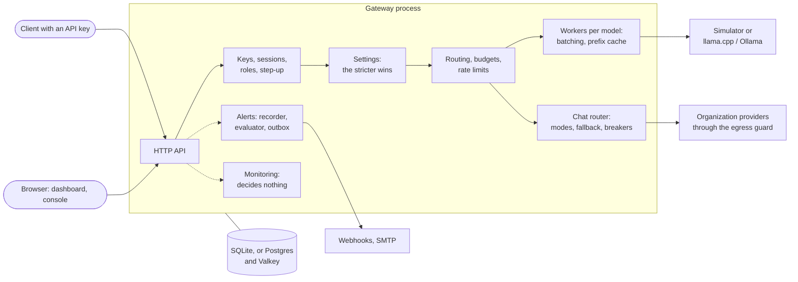
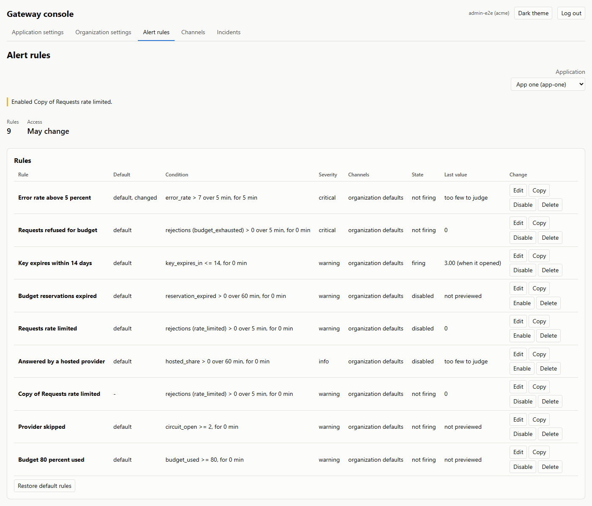
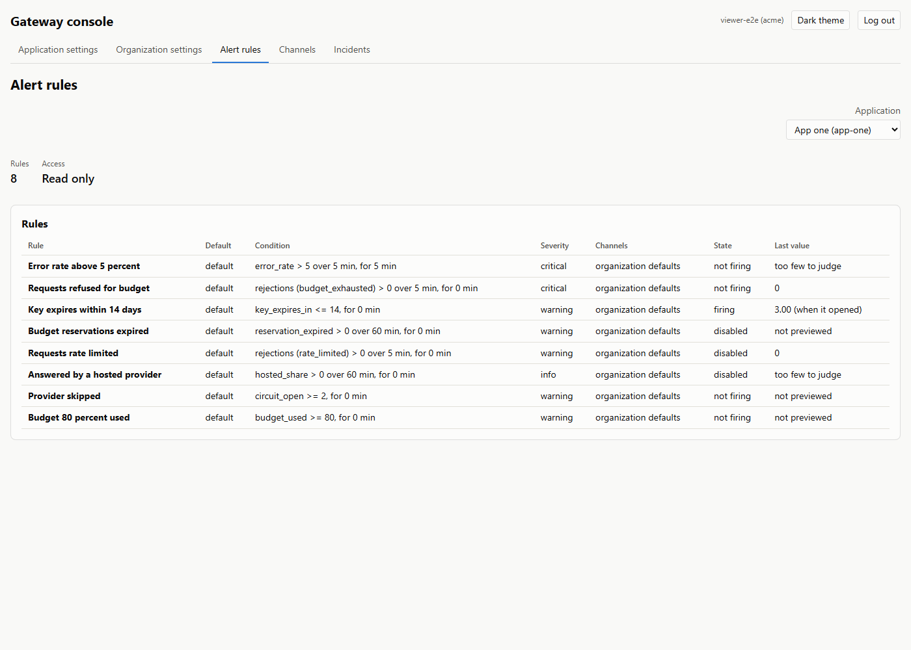
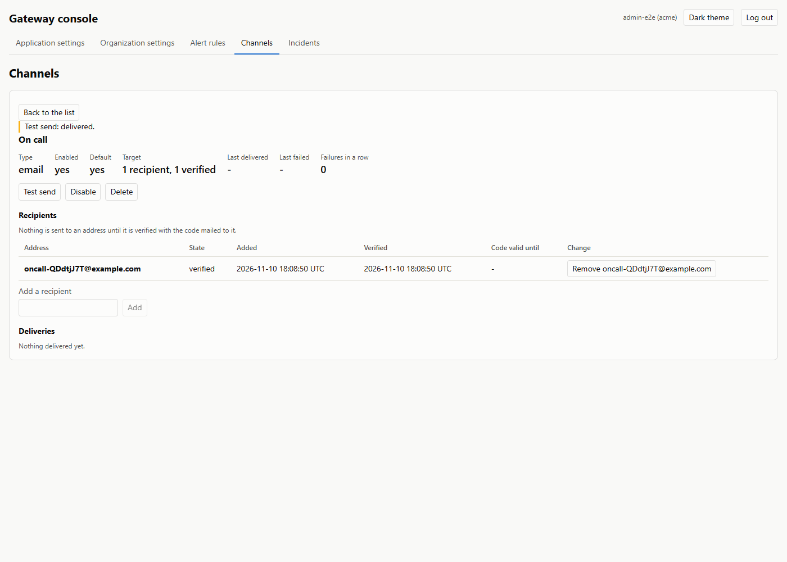
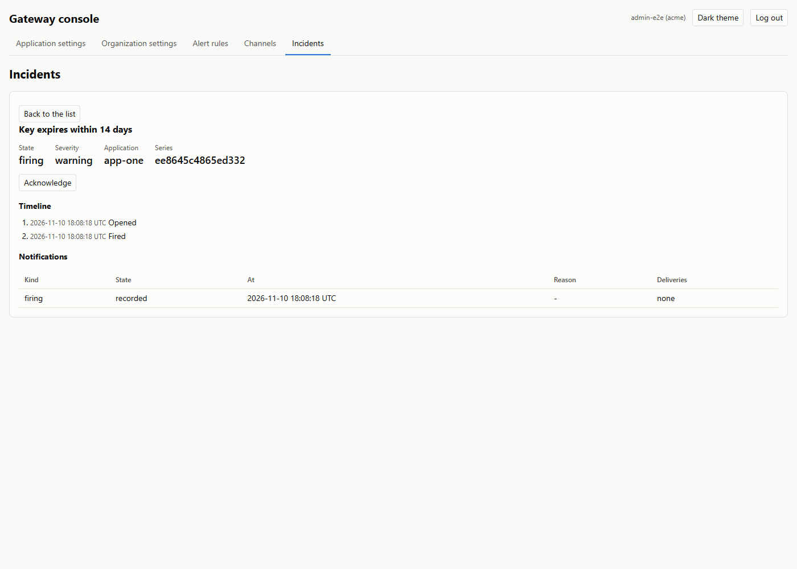
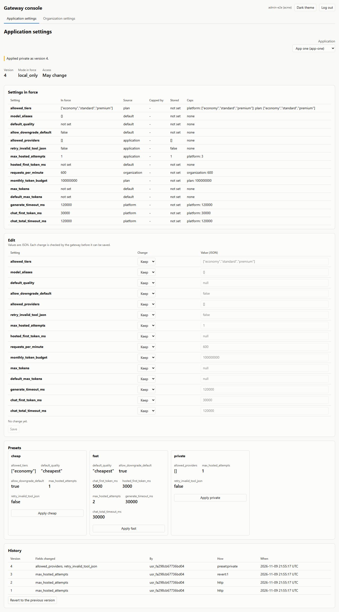
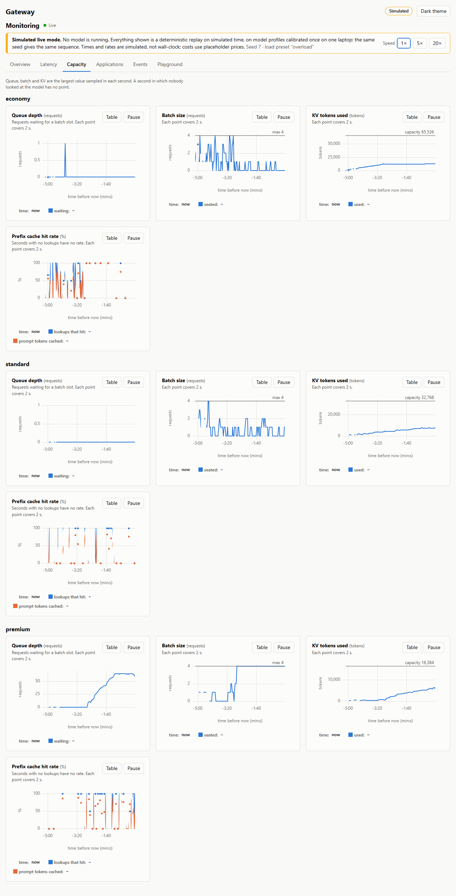

# Cost-aware multi-model inference gateway

[](https://github.com/bala5071/Multi-Model-Inference-Gateway-Simulator/actions/workflows/ci.yml)
[](LICENSE)

A gateway that sits in front of several language models and decides, for each request, which
model serves it, when, and what it costs whom. It routes by plan, batches per model, reuses
shared prompt prefixes, meters and limits each application, lets an organization bring its own
model providers behind a vault and an egress guard, runs on one SQLite file or on Postgres and
Valkey across several instances, and raises alerts to webhooks and verified email addresses.
An admin console and a monitoring dashboard sit on top.

**It is mostly a simulator.** The scheduler, cache, routing, limits, identity and alerting are
real code, but by default no model runs: time comes from a cost model fitted once to three real
models on one laptop. That makes every experiment exact and repeatable. Real models plug in
through llama.cpp or Ollama. Read [What it is not](#what-it-is-not) before any number.

## Why it exists

A company sells model access to business clients who are not alike: a startup on a free tier,
a team on a monthly plan, an enterprise with a contract. Serving them costs very different
amounts depending on the model, so the plan a client pays for decides which models it gets.

| Plan | Models it may use | | Tier | Model |
|---|---|---|---|---|
| free | economy | | economy | Llama 3.2 1B |
| pro | economy, standard | | standard | Llama 3.2 3B |
| enterprise | economy, standard, premium | | premium | Llama 3.1 8B |

The repository is also a record of how it was built: every step has a plan, tests, a
mutation check for each rule about who may do what, and a short design note saying what was
decided and why ([notes index](docs/README.md), [CONTRIBUTING.md](CONTRIBUTING.md)).

## See it running

```sh
docker compose up --build
```

Then open <http://localhost:8000/dashboard/>.



*Simulated, not a measurement.* The dashboard in simulated live mode: a seeded load replayed on
simulated time over the calibrated model profiles, here at five times real time. No model is
running. Taken with `scripts/capture_demo.py`, seed 7, at `613ca7a`
([note 17](docs/17-playground-load-replay.md), [note 18](docs/18-demo.md)).

The compose demo is built and started by CI on Linux on every push. Without Docker it needs
Python 3.11+, [uv](https://docs.astral.sh/uv/) and Node 20:

```sh
uv sync
cd frontend && npm ci && npm run build && cd ..
GATEWAY_SIMULATED_LIVE=1 GATEWAY_SIM_SPEED=5 GATEWAY_SEED=7 uv run python -m gateway.serve --port 8000
```

In Docker the bridge network counts as local (`GATEWAY_LOCAL_NETWORKS=172.16.0.0/12` in the
compose file), which is acceptable only for a local, single-user demo
([note 25](docs/25-local-only.md#docker)).

## Quick start

Needs Python 3.11+, [uv](https://docs.astral.sh/uv/), bash and curl. No model, no GPU.

`make demo` (or `uv run python scripts/demo.py`) runs the gateway in-process and walks through
three applications on three plans, a refused request, a prefix-cache hit, a streamed answer and
the usage ledger, in a couple of seconds.

The commands below start the plain server. **CI runs them exactly as written on every push**
(`scripts/readme_quickstart.py`), from the repository root. First the secrets, into a
git-ignored `gateway.env`: a pepper the server checks API keys with, the vault's master key, and
a first console admin, who must change the password at the first login. These are throwaway;
for real use keep them in a secrets store, because if the pepper or the master key is lost,
every key or provider secret must be issued again ([note 20](docs/20-applications-api-keys.md),
[note 32](docs/32-provider-settings-and-vault.md)).

<!-- quickstart -->
```sh
uv sync
uv run python -c "import secrets; print('GATEWAY_KEY_PEPPER=' + secrets.token_urlsafe(32))" > gateway.env
uv run python -c "import secrets; print('GATEWAY_VAULT_KEY=' + secrets.token_urlsafe(32))" >> gateway.env
uv run python -c "import secrets; print('GATEWAY_ADMIN_USERNAME=admin'); print('GATEWAY_ADMIN_PASSWORD=' + secrets.token_urlsafe(24))" >> gateway.env
set -a; . ./gateway.env; set +a
```

Applications and keys live in a SQLite database in your user data folder (outside the
repository; `GATEWAY_DATABASE` names another file). Create the three demo applications
(Initech on free, Globex on pro, Acme on enterprise) and issue a key for Acme. A key is
printed once and never stored; here it goes straight into a variable.

<!-- quickstart -->
```sh
uv run python scripts/manage.py seed-demo
export GATEWAY_API_KEY=$(uv run python scripts/manage.py create-key --application acme --label quickstart)
```

Start the server and wait until it answers. `gateway.serve` binds `127.0.0.1` and refuses any
other address while monitoring has no login ([Known gaps](#known-gaps),
[docs/25](docs/25-local-only.md)):

<!-- quickstart -->
```sh
uv run python -m gateway.serve --port 8000 &
SERVER=$!
until curl -sf http://127.0.0.1:8000/healthz > /dev/null; do sleep 1; done
```

Send a request as Acme: the best model its plan includes.

<!-- quickstart -->
```sh
curl -sf -X POST http://127.0.0.1:8000/v1/generate \
  -H "Authorization: Bearer $GATEWAY_API_KEY" -H "Content-Type: application/json" \
  -d '{"quality": "best", "prompt": "What is a radix tree?", "max_tokens": 16}'
```

```json
{"id":"req-1","text":"[simulated output, 16 tokens]","model":"premium",
 "usage":{"prompt_tokens":5,"cached_tokens":0,"completion_tokens":16,"total_tokens":21},
 "timing":{...},"cost":{"usd":...}}
```

Usage is kept in the database: stop the server, start it again, and Acme's request is still
counted against its monthly budget.

<!-- quickstart -->
```sh
kill $SERVER; wait $SERVER || true
uv run python -m gateway.serve --port 8000 &
SERVER=$!
until curl -sf http://127.0.0.1:8000/healthz > /dev/null; do sleep 1; done
curl -sf http://127.0.0.1:8000/v1/applications/me/usage -H "Authorization: Bearer $GATEWAY_API_KEY"
```

```json
{"application_id":"acme","name":"Acme","plan":"enterprise",...,
 "period":{"start_ms":...,"end_ms":...},"budget_tokens":100000000,"used_tokens":21,
 "total":{"requests":1,...},"by_model":{"premium":{"requests":1,...}}}
```

Then open <http://127.0.0.1:8000/docs>. The dashboard and the admin console are at
`/dashboard/` and `/dashboard/console.html` once built (`cd frontend && npm ci && npm run
build`). Accounts, roles, providers, fallback modes, settings, channels, several instances,
upgrades, real models and a curl tour are in [docs/operating.md](docs/operating.md).

## Architecture



The full diagram, with the vault, the egress guard and each store, is in
[docs/architecture.md](docs/architecture.md). Rules the code holds itself to: time is injected
(no `time.sleep` or wall clock in logic, enforced by the linter); one backend interface, the
simulated one deterministic for a seed; `app.py` is the only module that wires components;
monitoring never feeds back into scheduling, routing or admission ([CLAUDE.md](CLAUDE.md)).

## Features

Each item links the note that records how it was built and tested.

**Routing and providers**

- Routing by plan: a model name, or `cheapest`, `balanced` or `best`; asking for more than the
  plan includes is a 403 that says what it does include ([note 09](docs/09-routing.md)).
- Continuous batching per model, a radix-tree prefix-cache stand-in sharing the model's KV
  budget, chunked prefill, and overload protection (queue limits, timeouts, opt-in downgrade)
  ([notes 03](docs/03-continuous-batching.md), [04](docs/04-prefix-cache.md),
  [10](docs/10-overload.md), [11](docs/11-streaming-chunked-prefill.md)).
- `POST /v1/generate` and an OpenAI-format `POST /v1/chat/completions` with tools and streaming;
  adapters for Ollama, OpenAI-compatible servers and Anthropic ([note 31](docs/31-chat-and-adapters.md)).
- An organization's own providers, their keys sealed in a vault (AES-256-GCM), every outbound
  call through an egress guard (https, public addresses only, checked at connect, no redirects,
  no proxy, TLS 1.2 or higher) ([note 32](docs/32-provider-settings-and-vault.md)).
- Fallback modes, chosen by the organization and the application together, with circuit
  breakers and a cap on hosted attempts; every answer says where it came from
  ([note 33](docs/33-fallback-modes.md), [note 41](docs/41-breaker-reports-and-attempt-cap.md)).

**Identity and security**

- Applications and API keys stored only as an HMAC with a pepper from the environment, checked
  in constant time, rotated with a grace period ([note 20](docs/20-applications-api-keys.md)).
- Organizations, console users (argon2id, a password blocklist, lockout), sessions with CSRF,
  roles and one permission table with a generated [matrix](docs/permission-matrix.md), step-up
  for sensitive actions, an audit log ([notes 24 to 30](docs/README.md#design-notes)).
- One answer, byte for byte, for every refused login, key, step-up and confirmation code, each
  with a structural test that every case takes the same steps; a missing resource answered
  exactly as a forbidden one.
- Monitoring, the dashboard and the admin endpoints served to this machine only, refusing
  forwarded headers, foreign Host names and cross-site requests ([note 25](docs/25-local-only.md)).

**Scale-out**

- Every store behind an async protocol; SQLite for one process, or Postgres for the durable
  stores and Valkey for the counters across several instances, each atomic rule one statement
  or one script, failing closed ([notes 34 to 38](docs/README.md#design-notes)).
- Token budgets reserved before a request and settled after it on Postgres, so instances cannot
  overspend together ([note 37](docs/37-budgets-on-postgres.md)); migration from SQLite to
  Postgres and back, every table compared before anything is kept ([note 36](docs/36-postgres.md)).

**Settings**

- Per-application settings under the platform's, the plan's and the organization's caps, the
  stricter value winning in one function, read with the key in the same statement, versioned
  with one-step revert and a dry run ([note 39](docs/39-settings.md), [note 40](docs/40-settings-endpoints.md)).
- Settings that decide where prompts may go need the password again whenever a change loosens
  them for any application it affects; presets ([note 42](docs/42-hosted-settings-and-presets.md)).

**Alerts**

- A per-application recorder that never awaits, signals with minimums ("too few to judge",
  never 0), default and custom rules with a last-hour preview ([notes 43](docs/43-alert-recorder.md),
  [44](docs/44-alert-rules.md)).
- One evaluator at a time by a fenced lease, incidents with cooldown, reminders and quiet
  hours, and a heartbeat in `/healthz` ([note 45](docs/45-alert-evaluation.md)).
- Webhook channels (signed, the URL sealed and only its origin shown) and email channels
  through the operator's SMTP server to verified recipients only, through an outbox with
  retries and caps ([note 46](docs/46-alert-channels.md), [note 48](docs/48-email-channels.md)).

**Console and voice**

- An admin console (`/dashboard/console.html`): application and organization settings, alert
  rules, channels and recipients, incidents, the evaluator's state. It holds no rules of its
  own: who may write is asked of the gateway ([note 47](docs/47-console-settings.md),
  [note 49](docs/49-console-alerts.md)).
- A monitoring dashboard with per-second series, events and Prometheus `/metrics`
  ([note 15](docs/15-monitoring-api.md), [note 16](docs/16-dashboard.md)).
- **Voice: not built.** No speech endpoint exists; a chat request with an audio part is refused
  with 422 ([note 31](docs/31-chat-and-adapters.md)).

## Screenshots

| | |
|---|---|
|  **Alert rules, as an admin.** A real incident from the e2e seed is firing. |  **The same, as a viewer:** read only, because the gateway said so. |
|  **An email channel** after its recipient entered the mailed code and a test send. |  **An incident** with its timeline and notifications. |
|  **Application settings:** each value in force, where it came from, and its caps. |  **The dashboard's Capacity tab**, simulated. |

The console pictures were taken by its end-to-end tests (`frontend/e2e/`) against the plain
server on a throwaway database with test accounts, only after the test found none of the run's
secrets on the page (PRs #41 and #43). The test addresses are `@example.com`; mail went to the
suite's own SMTP server. The dashboard picture is simulated live mode, not a measurement. More:
[docs/pr-c1-screenshots/](docs/pr-c1-screenshots/), [docs/pr-c2-screenshots/](docs/pr-c2-screenshots/),
[docs/img/](docs/img/).

## Measured results

Three kinds of number, never to be compared with each other: **simulated** (the scheduler on
the calibrated profiles, exact and repeatable, not a benchmark of any model or machine),
**measured once against real models** (one laptop, through Ollama), and **measured on the
gateway itself** (the request path and its stores, on the same laptop). Every row names the
note with the command and the run; numbers measured at a past commit are marked with it,
**dated**: later code may have moved them. Machine: Intel Core Ultra 7 155H, 22 logical cores,
15.4 GB, Windows 11, Python 3.12.10; models on an RTX 4060 8 GB with Ollama 0.12.6; Postgres and
Valkey in Docker Desktop's Linux VM, so every round trip crosses into it. Ranges are over three
runs unless said otherwise.

| What | Result | Kind and caveat | Source |
|---|---|---|---|
| Continuous batching against one at a time, requests per second | 1.76x economy, 2.11x standard, 1.49x premium | Simulated, batches of at most 4. Rests on an **unstable** calibrated parameter: across the values it took, 1.48x to 1.97x, 1.96x to 2.79x and 1.04x to 2.52x | [REPORT §1](docs/REPORT.md), [note 13](docs/13-calibration.md) |
| Prefix cache, median time to first token, standard at 0.75 req/s, a 400-word shared prompt | 125.9 ms with, 280.2 ms without | Simulated; the cache is this repository's stand-in, its behaviour never measured | [REPORT §2](docs/REPORT.md) |
| Simulator against the real models, error on held-out requests | total latency 8%, 8%, 19%; time to first token 14%, 16%, 35% (economy, standard, premium) | Measured: six runs on one day (2026-10-08); seven of twelve parameters did not repeat; the 8B model partly on the CPU | [note 13](docs/13-calibration.md) |
| Accuracy on 100 MMLU questions, temperature 0 | economy 33% (25 to 43), standard 52% (42 to 62), premium 57% (47 to 66), 95% intervals | Measured once (2026-10-09); standard and premium cannot be told apart at this size | [note 14](docs/14-quality-eval.md) |
| One API key check, p50 | 0.024 to 0.029 ms | Measured on SQLite; dated, PR #36 | [note 45](docs/45-alert-evaluation.md) |
| One argon2id hash at the default (64 MiB, 3 iterations), p50; the last of 8 logins at once | 107.3 to 108.1 ms; 477.4 to 494.5 ms | Measured; dated, PR #5 | [note 24](docs/24-password-hashing.md) |
| Refused login on the running server, p50 | 112.9 to 117.0 ms for a known username, 110.9 to 112.4 ms for an unknown one | Measured; dated, PR #9. **A known username's failure is 3 to 7 ms slower on average**, which a patient local process could measure | [note 27](docs/27-users-and-sessions.md) |
| One shared counter call (the rate limit) in Valkey, p50 | 0.678 to 0.707 ms, against about 0.001 ms in memory | Measured at `5b088cf`; dated, PR #24 | [note 35](docs/35-valkey-counters.md) |
| One durable read (the key lookup), p50 | 1.065 to 1.081 ms on Postgres, 0.015 to 0.016 ms on SQLite | Measured at `d757093`; dated, PR #26 | [note 36](docs/36-postgres.md) |
| A chat request on the gateway's tier, whole request on Postgres, p50 | 14.120 to 14.674 ms; 5 store calls, 22 round trips | Measured with the store calls counted; dated, PR #39 | [note 46](docs/46-alert-channels.md) |
| One alert recorder call, p50 | 0.0011 to 0.0019 ms | Measured; dated, PR #34 | [note 43](docs/43-alert-recorder.md) |
| One steady alert evaluation cycle at 5,000 applications | 1,995 to 2,284 ms on SQLite, 1,960 to 2,424 ms on Postgres | Measured, off the request path; dated, PR #37. The first cycle, queuing 250 deliveries, took 4,084 to 4,174 ms on Postgres (PR #39) | [note 45](docs/45-alert-evaluation.md), [note 46](docs/46-alert-channels.md) |
| One webhook delivery in process, p50 | 2.984 to 3.227 ms on SQLite, 12.109 to 12.407 ms on Postgres | Measured against a scripted network, no receiver; dated, PR #39 | [note 46](docs/46-alert-channels.md) |

**Not reported:** any cost or saving (prices are placeholders, operator-supplied, never
measured), overload and chunked prefill results (not measured on real data), KV capacity, and
anything about a hosted provider or a real SMTP server. [docs/REPORT.md](docs/REPORT.md),
regenerated by `make report`, has the simulated and calibration results in full.

## What it is not

- **Not measured beyond one laptop.** Every timing, the calibration and the quality run are
  from one Windows laptop. Nothing was measured on another machine, under llama-server, or on a
  network.
- **Not a benchmark of any model or model server.** The simulated results show how this
  scheduler behaves with step costs fitted once; seven of the twelve fitted parameters did not
  repeat. With real models the model server does the batching, and this repository's
  scheduler, prefix cache and chunked prefill are not in the path ([note 12](docs/12-real-models.md)).
- **No hosted provider was tested live.** The OpenAI-compatible and Anthropic adapters are
  tested against mock providers and their published API descriptions; the live tests exist and
  are skipped unless someone runs them with their own keys. Only the local Ollama adapter ran
  against a real model ([note 31](docs/31-chat-and-adapters.md)).
- **Email was tested only against the suite's own SMTP server** (STARTTLS, a certificate made
  for the run), never a real mail server or a real inbox ([note 48](docs/48-email-channels.md)).
- **Webhooks were tested against scripted receivers,** never a real one ([note 46](docs/46-alert-channels.md)).
- **Not ready for a network.** The server binds `127.0.0.1`; monitoring, load control, the
  dashboard, console logins and the admin endpoints are served to this machine only, over plain
  HTTP, until a later step (A8) adds what a network needs ([note 25](docs/25-local-only.md),
  [SECURITY.md](SECURITY.md)).
- **No real prices.** Costs are computed from placeholder prices; no cost or saving is claimed.
- **No voice.** Audio is refused.
- **Not run:** the plain server in Docker (CI starts only the compose demo), and `make` (the
  development machine has none; its commands were run directly).
- **SQLite budgets are soft.** On one SQLite process a budget is checked on arrival and charged
  on completion, so requests in flight can cross it; reserved, hard budgets are on Postgres only
  ([note 37](docs/37-budgets-on-postgres.md)).

## Roadmap

Planned, in [docs/settings-and-alerts-plan.md](docs/settings-and-alerts-plan.md) and the
identity plan:

1. **A6: operator signals and channels:** notices to the operator about the gateway itself.
2. **A8: what a network needs:** logins and roles for monitoring and load control, limits per
   source address, then remote access to the console and the admin endpoints.

Not planned yet, from what the measurements showed:

3. Re-run the calibration under llama-server, with the 8B model fully on a GPU and concurrency
   past 4, until the cost per extra sequence repeats; model the per-request overhead better.
4. Measure what is a placeholder: real prices, KV capacity, a server's prefix-cache hits, long
   prompts for overload and chunked prefill.
5. Run the live provider tests, a real SMTP server and a real webhook receiver, and measure on
   a second machine.
6. Fairness between applications on the same model; overload detected from queue age; prefixes
   reusable as soon as they are prefilled; pepper rotation without re-issuing keys.

## Documentation

- [docs/README.md](docs/README.md): the index of the numbered design notes and the plans.
- [docs/operating.md](docs/operating.md): running the plain server.
- [docs/release-notes.md](docs/release-notes.md): what changed for an operator, by PR.
- [SECURITY.md](SECURITY.md): reporting, scope, the threat model and its limits.
- [CONTRIBUTING.md](CONTRIBUTING.md): plan first, mutation checks, measurement rules, the checks.
- [docs/licenses.md](docs/licenses.md): every shipped dependency and bundled dataset.

## License

[MIT](LICENSE) for the code. Third-party licences are in [docs/licenses.md](docs/licenses.md).
The Llama model weights are not part of this repository and are licensed separately by Meta
under a licence that is not open source.
