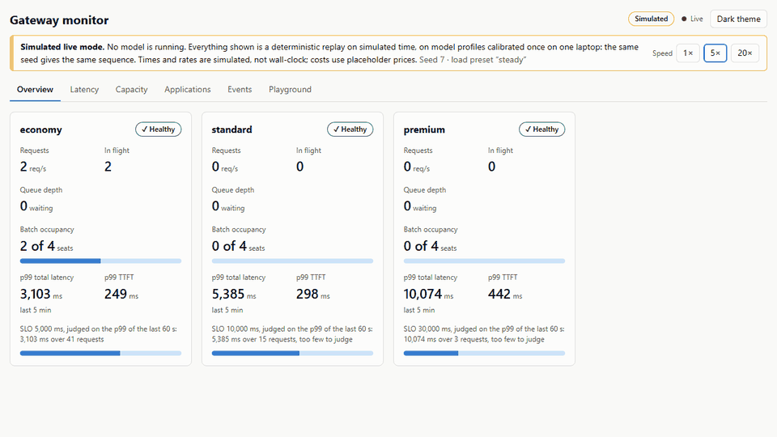
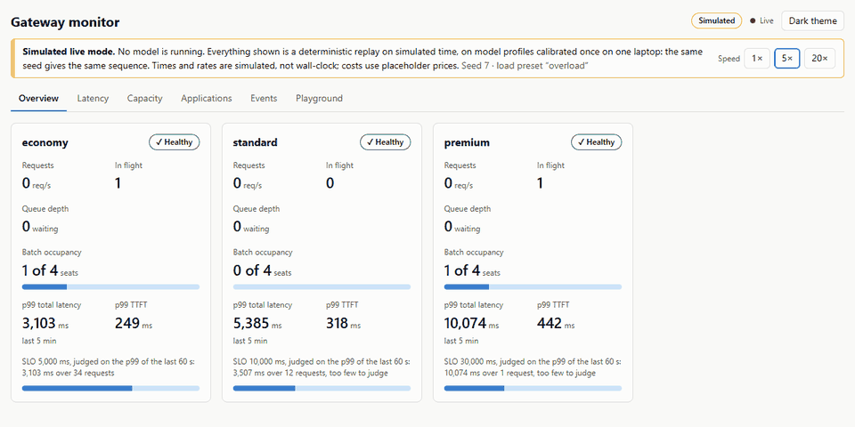
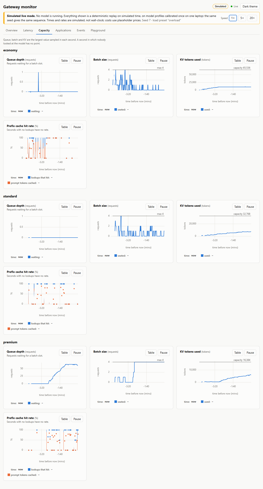
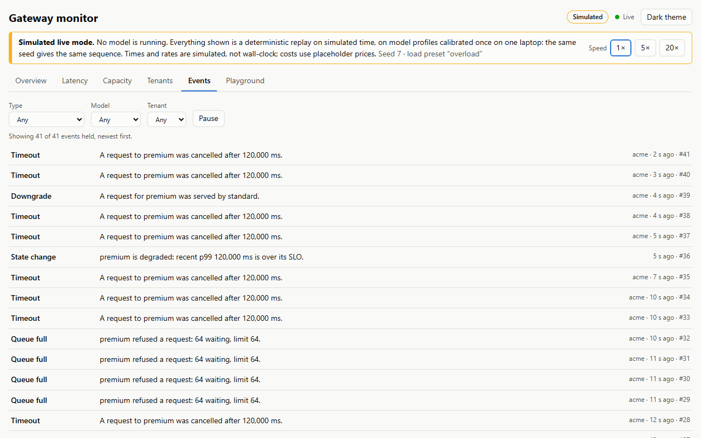
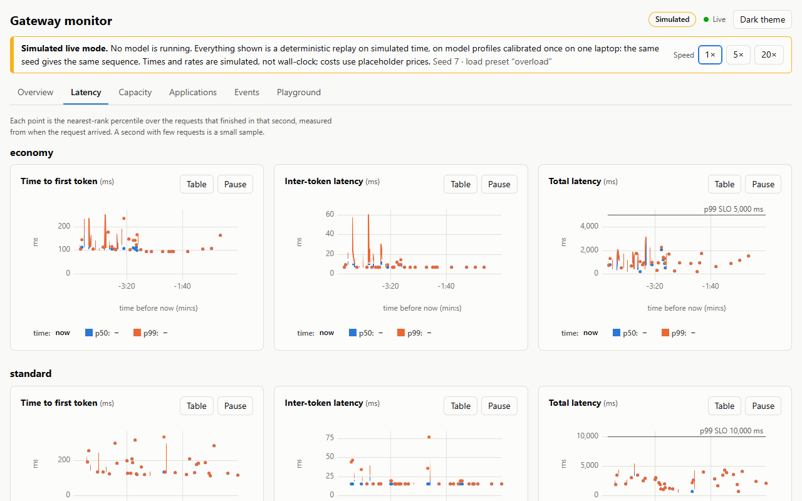
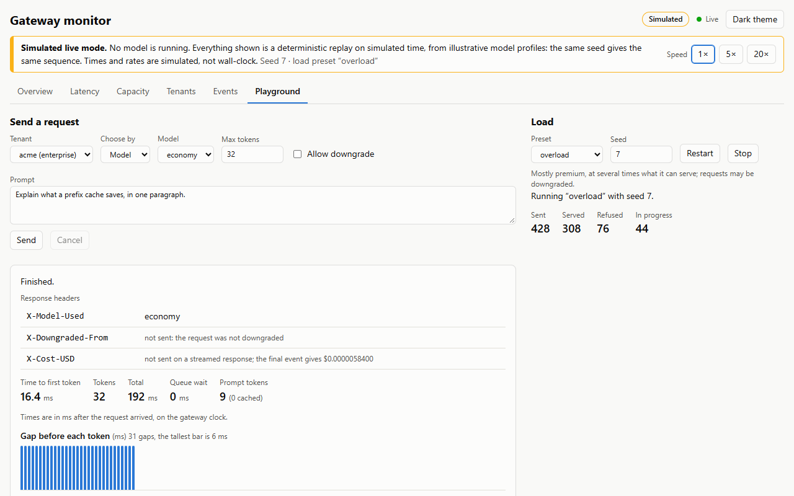
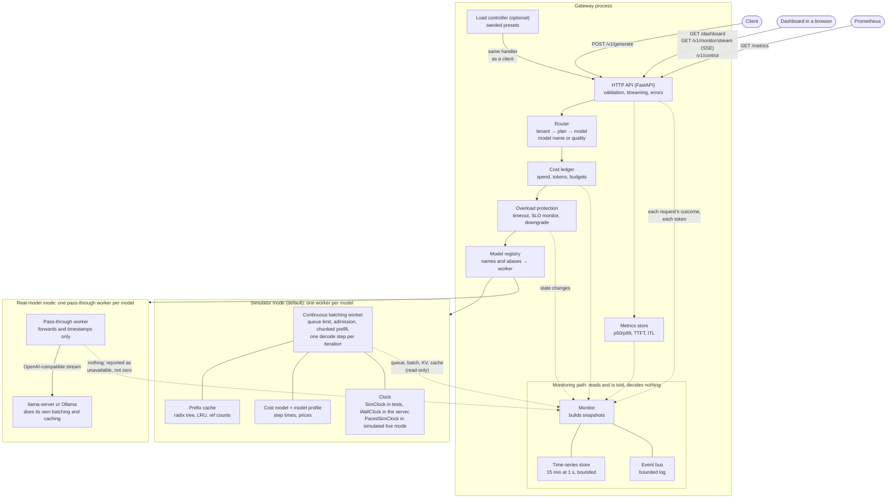
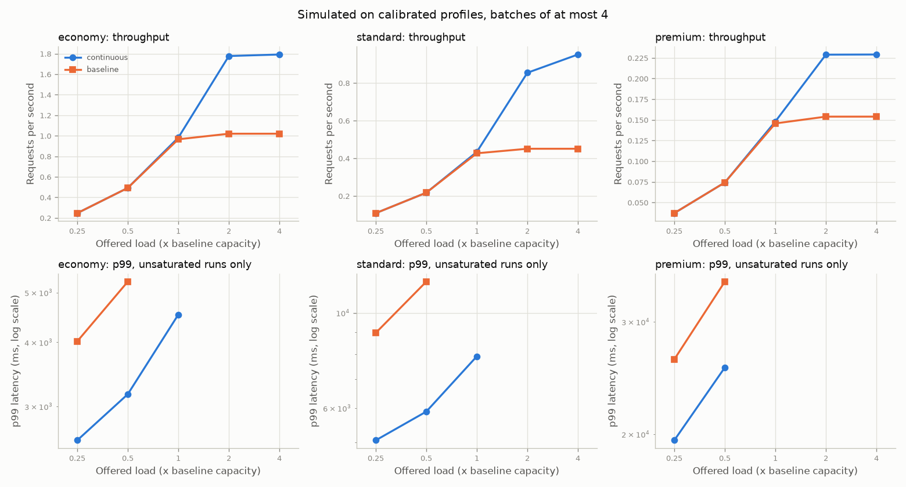
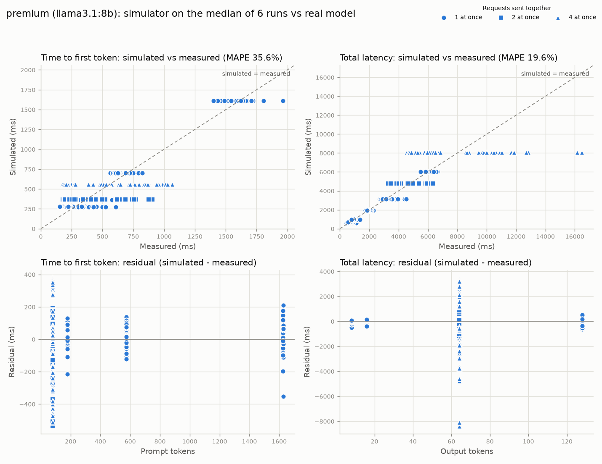

# Cost-aware multi-model inference gateway

[](https://github.com/bala5071/Multi-Model-Inference-Gateway-Simulator/actions/workflows/ci.yml)
[](LICENSE)

A gateway that sits in front of several language models and decides, for each request, which
model serves it, when, and what it costs whom.

## The product story

A company sells model access to business clients. The clients are not alike: a startup on a
free tier, a team on a flat monthly plan, an enterprise with a contract. Serving them costs
very different amounts depending on the model, so the plan a client pays for decides which
models it gets.

| Plan       | Models it may use            |
|------------|------------------------------|
| free       | economy                      |
| pro        | economy, standard            |
| enterprise | economy, standard, premium   |

| Tier     | Model         |
|----------|---------------|
| economy  | Llama 3.2 1B  |
| standard | Llama 3.2 3B  |
| premium  | Llama 3.1 8B  |

The gateway enforces that, and tries to serve everyone efficiently while doing it:

- **Routing by plan.** A client names a model, or just asks for `cheapest`, `balanced` or
  `best`, and gets the right model for its plan. Asking for more than the plan includes is a
  403 that says what the plan does include.
- **Metering and budgets.** Every request is charged to its tenant. A monthly token budget
  stops a tenant when it is used up.
- **Continuous batching** per model, so one model serves many requests at once.
- **Prefix reuse**, so a system prompt shared by many requests is processed once.
- **Overload protection**: queue limits, timeouts, and an opt-in downgrade to a cheaper model
  when the requested one is too slow.
- **Latency reporting** (p50/p99, time to first token, inter-token latency) and a **CI gate**
  that fails the build when p99 regresses.

**What this repository is.** Mostly a *simulator*: the scheduler, cache, routing and limits
are real code, but by default no model runs and time is simulated from a small cost model.
That makes every experiment exact and repeatable. Real models can be plugged in through
llama.cpp or Ollama, and one calibration against real models is included. The two modes
answer different questions; see [Limitations](#limitations).

It also has a monitoring dashboard, and a demo mode in which the dashboard can be watched
with no model at all.

## See it running

```sh
docker compose up --build
```

Then open <http://localhost:8000/dashboard/>.



*A silent tour of every tab, about 36 seconds: steady load, one streamed request, then the
`overload` preset until premium and standard are marked degraded and requests move to
cheaper models. Simulated, not a measurement.*

**This is simulated live mode. No model is running, and nothing in these pictures is a
measurement.** The gateway replays a seeded load on simulated time, on the calibrated model
profiles (step costs measured once on one laptop; prices are placeholders), here at five
times real time. It exists so that the scheduler, the limits and the
dashboard can be watched working with nothing else installed; the same seed gives the same
sequence of events on any machine
([docs/17](docs/17-playground-load-replay.md), [docs/18](docs/18-demo.md)).



In this GIF the `overload` preset sends the premium model about three times what it can
serve: its batch fills at 4, its queue grows, and its p99 passes the SLO. It is not marked
degraded yet, and the card says why: too few requests have finished in the SLO window to
judge. Later it is, and requests that allow it are served by the standard model; the tour
above and the Events picture below show that.

| | |
|---|---|
|  Queue, batch, KV and cache for every model through the same overload; premium is at the bottom |  Every downgrade, refusal and state change, as it happens |
|  p50 and p99 per second, with the SLO where it is in range |  One streamed request, token by token, and the load controls |

The pictures and both GIFs were taken with `uv run python scripts/capture_demo.py`, seed
7, with `PLAYWRIGHT_CHANNEL=chrome`, on the tree of the commit that added the tour (parent
commit `879ee2f`).

**Docker has not been run for this project**: the development machine does not have it
([Limitations](#limitations)). What was run is the same thing without it, which needs
Python 3.11+, [uv](https://docs.astral.sh/uv/) and Node 20:

```sh
uv sync
cd frontend && npm ci && npm run build && cd ..
GATEWAY_SIMULATED_LIVE=1 GATEWAY_SIM_SPEED=5 GATEWAY_SEED=7 uv run uvicorn gateway.app:create_default_app --factory --port 8000
```

On the Playground tab, choose the `overload` preset and press Restart to see what the GIF
shows.

## Architecture



Solid arrows are the request path. Dotted arrows are observation: the monitoring path is
told what happened and reads the rest, and no scheduling, routing or admission code reads
anything back from it. Behind a pass-through worker the gateway cannot see the model
server's queue, batch or cache, and the dashboard says "not available in this backend"
instead of showing zeros ([docs/15](docs/15-monitoring-api.md)).

Rules the code holds itself to (details in [CLAUDE.md](CLAUDE.md)):

- **Time is injected.** Every component takes a clock. Tests and benchmarks run on a
  simulated clock; nothing in the logic calls `time.sleep` or reads the wall clock, and the
  linter enforces it.
- **One backend interface.** The simulated backend is deterministic for a seed.
- **Only the API module imports the web framework** and wires components together.

## Quickstart

Needs Python 3.11+ and [uv](https://docs.astral.sh/uv/). Nothing else.

### Simulator mode (zero setup)

```sh
uv sync
make demo        # or: uv run python scripts/demo.py
```

The demo runs the gateway in-process and walks through three tenants on three plans, a
request outside a plan, a prefix-cache hit, a streamed answer and the usage ledger. It takes
a couple of seconds and needs no server.

To run it as a server:

```sh
make serve       # or: uv run uvicorn gateway.app:create_default_app --factory --port 8000
```

Since platform step 2 the server needs `GATEWAY_KEY_PEPPER` set (it refuses to start
without it) and every request needs an application's API key, issued with
`scripts/manage.py`; see [note 20](docs/20-applications-api-keys.md). This README's commands
are brought up to date in step 6 of the [platform plan](docs/platform-plan.md).

Then open <http://127.0.0.1:8000/docs>. The dashboard is at `/dashboard/` once it has
been built (`cd frontend && npm ci && npm run build`, Node 20;
[docs/16-dashboard.md](docs/16-dashboard.md)).

`docker compose up --build` starts the demo of [See it running](#see-it-running), not this
plain server; the compose file says which lines to remove for a plain one.

### Real-model mode

1. Get three models running, either as three llama.cpp servers
   (`scripts/run_local_models.sh start`) or through Ollama
   (`ollama pull llama3.2:1b-instruct-q4_K_M && ollama pull llama3.2:3b && ollama pull llama3.1:8b`).
2. Start the gateway pointing at them:

   ```sh
   GATEWAY_BACKEND=llamacpp make serve                                # llama-server
   GATEWAY_BACKENDS=examples/backends.ollama.yaml make serve          # Ollama
   ```

Hardware needs, the Llama license, and what changes in this mode are in
[docs/12-real-models.md](docs/12-real-models.md). The model weights are under Meta's Llama
license, which is not an open-source license.

## Curl demo

With the server running (simulator mode shown; the three demo tenants are `initech` on free,
`globex` on pro and `acme` on enterprise). **Out of date since platform step 2:** send
`-H "Authorization: Bearer <key>"` instead of a `tenant_id`, and read usage from
`/v1/applications/me/usage` ([note 20](docs/20-applications-api-keys.md)):

```sh
# The best model the tenant's plan includes.
curl -s -i -X POST http://127.0.0.1:8000/v1/generate -H "Content-Type: application/json" \
  -d '{"tenant_id": "acme", "quality": "best", "prompt": "What is a radix tree?", "max_tokens": 32}'
# HTTP/1.1 200 OK
# x-model-used: premium
# x-cost-usd: 0.0000552000

# A model outside the plan.
curl -s -X POST http://127.0.0.1:8000/v1/generate -H "Content-Type: application/json" \
  -d '{"tenant_id": "initech", "model": "premium", "prompt": "hello"}'
# {"error": {"code": "model_not_in_plan", "message": "Tenant 'initech' is on the 'free' plan,
#   which does not include model 'premium'. Models on this plan: economy. Plans that include
#   'premium': enterprise.", ...}}

# Streaming, one event per token.
curl -s -N -X POST http://127.0.0.1:8000/v1/generate -H "Content-Type: application/json" \
  -d '{"tenant_id": "acme", "model": "economy", "prompt": "hello", "max_tokens": 4, "stream": true}'

# What a tenant has used, and the gateway's own view of latency and load.
curl -s http://127.0.0.1:8000/v1/tenants/acme/usage
curl -s http://127.0.0.1:8000/metrics/summary
curl -s http://127.0.0.1:8000/v1/overload

# For a dashboard: everything now with the last minute per second, the same as a live
# stream, and Prometheus text. Schema in docs/15-monitoring-api.md.
curl -s "http://127.0.0.1:8000/v1/monitor/snapshot?history_s=60"
curl -s -N http://127.0.0.1:8000/v1/monitor/stream
curl -s http://127.0.0.1:8000/metrics
```

In simulator mode the `text` field is a placeholder; in real-model mode it is the model's
answer. The full API is in [docs/06-api.md](docs/06-api.md) and the notes after it.

## Headline results

Three kinds of number follow: simulated, measured timing, and measured accuracy. Each table
says which it is.

Full tables, figures and the command behind every number are in
[docs/REPORT.md](docs/REPORT.md), regenerated by `make report`.

**The simulated results run on the calibrated profiles**: the timing of each model is the
median of six calibration runs of the real models on one laptop with Ollama (the 8B model
partly on the CPU), and batches stop at 4, the most requests that were measured together.
They show how this scheduler behaves with those step costs, not how fast any model server is.
Every workload was checked first so that no model is saturated, since a saturated run's p99
only measures how long the run was.

| Question | Result |
|---|---|
| Does continuous batching help? | Simulated: with batches of at most 4, it serves 1.76x, 2.11x and 1.49x the one-at-a-time baseline's requests per second on economy, standard and premium. That rests on the cost per extra sequence, which did not repeat between calibration runs: across the values it took, 1.48x to 1.97x, 1.96x to 2.79x and 1.04x to 2.52x. |
| Does the prefix cache help? | Simulated, standard model at 0.75 req/s: when every request shares a 400-word system prompt, median time to first token is 125.9 ms with the cache and 280.2 ms without. Most of the cached figure is a fixed per-request overhead the cache cannot remove. The cache's behaviour itself is this repo's stand-in, not measured. |
| What does routing by plan save? | **Not reported.** Prices were never measured; the ones in the code are placeholders, operator-supplied, not data. |
| What happens under overload? | **Not measured on real data.** The mechanism (queue limits, timeouts, downgrade) is described and tested; no results are given ([docs/10](docs/10-overload.md)). |
| Does chunked prefill help? | **Not measured on real data.** The workload that shows it needs prompts far beyond the measured range ([docs/11](docs/11-streaming-chunked-prefill.md)). |



**The calibration itself is measured** on one laptop (Core Ultra 7 155H, RTX 4060 8 GB,
Ollama 0.12.6), against the three real models. Each value is the median of six runs made
on 2026-10-08, with the range over those runs in brackets; errors are against held-out
requests:

| Tier | Prefill ms/token | Decode step ms | ms per extra sequence | Per-request overhead ms | Simulator error: TTFT | Simulator error: total latency |
|---|---:|---:|---:|---:|---:|---:|
| economy (1B)  | 0.20 (0.18-0.21) | 6.7 (6.5-6.7)    | 2.7 (2.1-3.7) *    | 90 (75-114) *  | 14% | 8%  |
| standard (3B) | 0.38 (0.35-0.42) | 15.3 (14.7-22.2) * | 4.1 (1.7-4.9) *  | 88 (65-126) *  | 16% | 8%  |
| premium (8B)  | 0.86 (0.76-0.96) | 45.1 (42.8-48.3) | 24.8 (7.7-42.9) *  | 162 (42-236) * | 35% | 19% |

\* Unstable: the range is more than 25% of the median, so the value did not repeat. That is
seven of the twelve, including the cost per extra sequence on every tier. The premium tier
is also hardware-limited: Ollama had 5% of the 8B model on the CPU because it does not fit
the 8 GB GPU.

These medians are what the simulator runs on. Earlier drafts of this project used invented
profiles instead; their results were removed
([docs/13](docs/13-calibration.md#what-changed-the-invented-profiles-were-removed)).

**What the cheaper plans give up, measured once.** Each real model answered the same 100
multiple-choice questions (a random sample of MMLU, MIT license) at temperature 0, scored
by exact match on the option letter. One run on the same laptop on 2026-10-09; guessing
scores about 25%. No cost is set beside it: prices were never measured.

| Plan | Best model included | Accuracy (95% interval) | Accuracy given up against premium (95% interval) |
|---|---|---:|---:|
| free       | economy (1B)  | 33% (25% to 43%) | 24 points (14 to 34) |
| pro        | standard (3B) | 52% (42% to 62%) | 5 points (-3 to 13) |
| enterprise | premium (8B)  | 57% (47% to 66%) | nothing |

The 1B model is clearly worse on this set; the 3B and 8B models cannot be told apart at
this sample size. 17 of the 1B model's replies did not open with an option letter and
count as wrong, and all three models lean towards option A, so part of every score is the
format. See [docs/14-quality-eval.md](docs/14-quality-eval.md) and
[report, section 7](docs/REPORT.md).



What the measurement says about the simulation:

- **Batching is far from free on these models.** Each extra request in a batch added 27% to
  55% to the step time ([docs/13](docs/13-calibration.md)). By the fitted parameters, four
  requests together give at most a little over twice the throughput of one, not four times,
  and how they behave with more than four was never measured.
- **Once calibrated, the simulator is closer on total latency than on time to first
  token**: 8% to 19% off against 14% to 35% in the table above, and 17% to 49% off on time
  to first token when four requests arrive together
  ([docs/13](docs/13-calibration.md)). Real requests carry a fixed cost of roughly 90 to
  160 ms; the cost model now has a constant for it, and it is the least stable parameter.

Details and caveats: [docs/13-calibration.md](docs/13-calibration.md).

## Design decisions and trade-offs

| Decision | Why | What it costs |
|---|---|---|
| Simulate first, on an injected clock | Every experiment is exact and repeatable, so tests can assert timings to the millisecond and the CI gate cannot flake | The numbers are only as good as the cost model, and it is simple |
| One worker, queue and cache per model | A flooded model cannot slow another; with separate workers the light model's latency is identical with and without the heavy load | No sharing of capacity between models, and no fairness between tenants on the same model |
| Backend says what, worker says when | The same simulated backend serves the baseline and the batching scheduler, so they are compared on identical work | A real model server cannot be driven step by step, so real-model mode bypasses the scheduler |
| Prefix cache as a radix tree sharing the model's KV budget with running requests | Cached prefixes are the idle part of the KV memory, not a second budget; in-use prefixes are pinned | A prefix is only reusable once its first request finishes, so a cold burst gets no sharing |
| Strict first-come-first-served admission | Predictable, and a large request cannot starve | Leaves capacity unused when the head of the queue does not fit |
| Budgets checked on arrival, charged on completion | Output length is not known in advance | A soft limit: the request that crosses the budget, and any in flight with it, are served |
| 429 for an exhausted budget and for a full queue | Both are "retry later" with a `Retry-After`; the error code tells them apart | A client must read the code, not just the status |
| Downgrade is opt-in per request, with hysteresis | Nobody is silently given a weaker model; two thresholds and a hold time stop it flapping | It reacts only after slow requests finish, so the first ones still wait |
| Streaming waits for the first token before sending headers | Every failure before any output keeps its proper status code | The client sees nothing during queueing and prefill |
| Chunked prefill gives each request its own chunk per iteration | Short prompts are not held up behind a long one, and nothing starves | The stall per iteration grows with the number of requests prefilling at once |
| Performance gate at 2% tolerance | The simulator has no noise; at 10% a doubled prefill cost would pass | Small intended changes need a re-baseline |
| The calibration is the default profile set, batches capped at 4 | Every simulated result rests on measured step costs, and nothing extrapolates past the measured batch size | Seven of its twelve parameters did not repeat, it is one laptop, and earlier results had to be removed rather than kept reproducible |

Each step's reasoning is in its own note; start from the [docs index](docs/README.md).

## Limitations

**Simulated against measured.** This is the limitation to read first, because the numbers
in this README are of three different kinds.

- **Most results here are simulations on profiles calibrated once.** Report sections 1 to 3,
  the performance gate, and everything the dashboard shows in simulated live mode run on the
  median of six calibration runs on one laptop with Ollama, the 8B model partly on the CPU,
  with batches of at most 4. They are exact and repeatable, and they are not benchmarks of
  Llama models, of a model server or of any hardware. The performance gate protects the
  scheduler logic; it does not measure hardware.
- **Seven of the twelve calibrated parameters are unstable**, including the cost per extra
  sequence on every tier, which the batching results rest on. The report shows how far those
  results move across the measured values.
- **Never measured: prices, KV capacity, and the prefix cache's behaviour.** Prices and KV
  capacities are placeholders, operator-supplied, not data, and no cost or saving is
  reported. Overload and chunked prefill have no results: not measured on real data.
- **With real models, this repo's scheduler is not what does the batching.** The model
  server does. The gateway still routes, meters, limits and times, but continuous batching,
  the prefix cache and chunked prefill here are not exercised. A real-mode latency says
  nothing about whether this scheduler is good, and simulated and real numbers must not be
  compared directly.
- **The dashboard cannot see inside a real model server.** In real-model mode its queue,
  batch, KV and cache panels say "not available in this backend".

**What was measured, and how thinly.**

- **One laptop** (Core Ultra 7 155H, RTX 4060 8 GB). Nothing was measured on any other
  machine.
- **Through Ollama, not llama-server.** The llama.cpp backend speaks the same protocol and
  is covered by tests against a mock server, but no real model has been run under
  llama-server for this project.
- **The calibration is six runs on one day**, with concurrency up to 4, and seven of its
  twelve parameters did not repeat between runs, including the cost per extra sequence on
  every tier.
- **The 8B model did not fit on the 8 GB GPU** and ran partly on the CPU, so the premium
  tier's timings are of that laptop's limits as much as of the model.
- **Answer quality is 100 multiple-choice questions, asked once.** Each accuracy has a 95%
  interval 18 to 19 points wide; the 3B and 8B models cannot be told apart at that size. It
  measures picking a letter on exam questions, not how good an answer to a tenant's own
  request is, and the simulator does not model quality at all.

**The model and the system.**

- **The cost model is simple.** Prefill is linear in tokens, a decode step is linear in batch
  size, the per-request overhead is a constant (and unstable), and each
  model has its hardware to itself. After calibration its time to first token is still
  17% to 49% off when four requests arrive together.
- **One token is one word** in the simulator; output length is known at admission.
- **Prices and budgets are placeholders**, operator-supplied, not data.
- **No authentication.** A tenant id is taken on trust; anyone who can reach the gateway can
  read any tenant's usage, open the dashboard, and, where load control is enabled, start
  load. Load control is off by default for that reason. The server binds to `127.0.0.1`;
  **do not expose it to a network.** API keys and persistent usage are being added
  ([platform plan](docs/platform-plan.md)); monitoring and load control stay
  unauthenticated until a later phase protects them with roles.
- **State is in memory and per process**: ledger, metrics, monitoring history, cache and
  overload state are lost on restart and not shared between instances.

**Not run.**

- **Docker.** The Dockerfile and the compose file, including the one-command demo at the top
  of this page, were written but never built or run: the development machine has no Docker.
- **make.** The machine has none either; every Makefile command was run directly instead.
- **CI.** Nothing has been pushed, so no workflow has run and the badge above has no status.
  That includes the jobs that would build the image and run the browser tests.
- **The browser tests** were run with an installed Chrome on that one Windows laptop, not
  with the Chromium CI would download.

## What I would do next

1. **Model the per-request overhead better.** It is a constant now, it did not repeat
   between runs, and time to first token is where the simulator is furthest off.
2. **Re-run the calibration properly**: under llama-server, with the 8B model fully on a
   GPU, concurrency past 4 and a quieter machine, until the cost per extra sequence repeats;
   then re-baseline the gate.
3. **Measure what is now a placeholder or missing**: real prices, KV capacity, a server's
   prefix-cache hits, and long prompts, so overload and chunked prefill can have results.
4. **Make prefixes reusable as soon as they are prefilled**, so a cold burst shares them.
5. **Fairness between tenants on the same model**; today isolation is only between models.
6. **Detect overload from queue age**, not only from finished requests, so downgrade engages
   before the first slow request completes.
7. **Hard budgets**, by reserving `max_tokens` up front.
8. **Authentication and a durable ledger**, the two things a real deployment needs first.
9. **A backend that exposes single decode steps**, so this scheduler can drive a real model
   and be compared with llama-server's own.

## Development

```sh
make check       # lint, type check, tests, performance gate (what CI runs)
make bench       # every simulated benchmark
make report      # regenerate docs/REPORT.md and its figures
make calibrate BACKENDS=examples/backends.ollama.yaml    # needs real models running
```

The dashboard has its own checks, run in `frontend/` (Node 20):

```sh
npm run check    # eslint, prettier, tsc, component tests
npm run e2e      # browser smoke tests against the gateway in simulated live mode
```

### Protected outputs

The performance gate results, the load generator's output, the report and the tracked
benchmark data must not change while the platform work goes on
([plan, section 5](docs/platform-plan.md)). Their sha256 sums are committed in
[scripts/protected_outputs.sha256](scripts/protected_outputs.sha256):

```sh
uv run python scripts/protected_outputs.py    # regenerate, compare; exits 1 on any change
```

A changed sum is a failure to explain, not a file to refresh. Refresh the baseline only
when a change to one of those outputs is intended and understood:

1. Run the check and note exactly which sums changed and why.
2. Run `uv run python scripts/protected_outputs.py --update`, which rewrites the baseline.
3. Commit the new `scripts/protected_outputs.sha256` on its own, with the reason and the
   list of changed files in the commit message and the pull request.

Text files are hashed with Windows line endings read as Unix ones, so a checkout on either
system gives the same sums. `docs/REPORT.md` is hashed without the line naming its commit.

Without `make`, run the commands from the [Makefile](Makefile) directly. See
[CONTRIBUTING.md](CONTRIBUTING.md) for the rules and [docs/README.md](docs/README.md) for the
documentation index.

## License

[MIT](LICENSE) for the code. The Llama model weights are not part of this repository and are
licensed separately by Meta.
