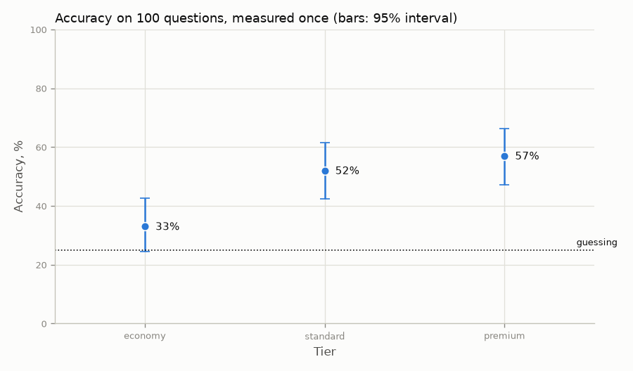

# Results report

Generated by `uv run python -m benchmarks.report` (or `make report`) from commit `38bbb94 with uncommitted changes`.
Do not edit by hand; change `benchmarks/report.py` and regenerate.

**Sections 1 to 3 are simulated** with seed 7 on the calibrated model profiles: the median
of six calibration runs of the real models, on one laptop with Ollama, the 8B model partly on
the CPU, with batches of at most the 4 requests that were measured together. They are
deterministic: the same code and calibration give the same numbers. **Sections 4 and 5 have no
results: not measured on real data.** **Sections 6 and 7 are measured** on real models and are
read from files, not re-measured. Nothing here is a benchmark of real hardware except where
those sections say so.

Times are in milliseconds unless stated. Percentiles are nearest-rank.

## 1. Baseline vs continuous batching

**Simulated** on the calibrated profiles (`benchmarks/calibration/calibrated_profiles.json`, section 6): the median of calibration runs on one laptop with Ollama, batches of at most 4, the most requests that were measured together. This is this repo's scheduler with measured step costs, not a measurement of a real server. **Unstable parameters** (did not repeat between runs): economy: decode_ms_per_extra_seq, per_request_overhead_ms; standard: decode_base_ms, decode_ms_per_extra_seq, per_request_overhead_ms; premium: decode_ms_per_extra_seq, per_request_overhead_ms. **Hardware-limited** (model partly on the CPU): premium.

300 requests per run with prompts of 20 to 400 words, arriving as a
Poisson stream. "Load" is the arrival rate as a multiple of what the one-at-a-time baseline can
sustain on that model, so 1x is the baseline's limit. Both workers get identical arrivals. No
prefix cache. A model counts as saturated when it is offered more than 60% of its capacity (requests per second when the same requests arrive all at once), or when its p99 grows by more than 25% as the run is doubled. A saturated run's p99 measures how long the run was, so it is not reported. Here capacity is each worker's own on these 300
requests.


| Tier | Load | Offered req/s | Baseline req/s | Baseline p99 ms | Continuous req/s | Continuous p99 ms |
|---:|---:|---:|---:|---:|---:|---:|
| economy | 0.25x | 0.25 | 0.25 | 4,016.8 | 0.25 | 2,577.4 |
| economy | 0.5x | 0.49 | 0.49 | 5,249.8 | 0.49 | 3,169.1 |
| economy | 1x | 0.99 | 0.97 | saturated | 0.98 | 4,529.0 |
| economy | 2x | 1.97 | 1.02 | saturated | 1.78 | saturated |
| economy | 4x | 3.94 | 1.02 | saturated | 1.79 | saturated |
| standard | 0.25x | 0.11 | 0.11 | 8,980.6 | 0.11 | 5,047.7 |
| standard | 0.5x | 0.22 | 0.22 | 11,820.9 | 0.22 | 5,887.6 |
| standard | 1x | 0.44 | 0.43 | saturated | 0.43 | 7,919.5 |
| standard | 2x | 0.87 | 0.45 | saturated | 0.85 | saturated |
| standard | 4x | 1.74 | 0.45 | saturated | 0.95 | saturated |
| premium | 0.25x | 0.04 | 0.04 | 26,195.7 | 0.04 | 19,563.4 |
| premium | 0.5x | 0.07 | 0.07 | 34,677.3 | 0.07 | 25,439.4 |
| premium | 1x | 0.15 | 0.15 | saturated | 0.15 | saturated |
| premium | 2x | 0.30 | 0.15 | saturated | 0.23 | saturated |
| premium | 4x | 0.59 | 0.15 | saturated | 0.23 | saturated |

Below its capacity a worker keeps up, so its throughput is the arrival rate and the difference
is in latency. Past it, throughput stays at capacity and the queue grows for the whole run.

**Capacity of continuous batching over the baseline**, with batches of at most the
measured number of requests. The cost per extra sequence is the parameter this rests on, so
the gain is also shown with that parameter at the lowest and the highest value the
calibration runs fitted (both measured; every other parameter at its median):

| Tier | Largest batch (measured) | Gain, median cost per extra sequence | Gain, lowest fitted cost | Gain, highest fitted cost |
|---:|---:|---:|---:|---:|
| economy | 4 | 1.76x | 1.97x | 1.48x |
| standard | 4 | 2.11x | 2.79x | 1.96x |
| premium | 4 | 1.49x | 2.52x | 1.04x |

**The cost per extra sequence is unstable on economy, standard, premium**: it did not
repeat between calibration runs (section 6), and the two right-hand columns show how far the
gain moves across the values it took. Nothing here batches more requests than were measured
together, so nothing is extrapolated past that. `per_request_overhead_ms` does not hold up the
model, so it moves time to first token and not these capacities.

Reproduce this section: `uv run python -m benchmarks.report --only batching`

## 2. Prefix cache on and off

**Simulated** on the calibrated profiles (`benchmarks/calibration/calibrated_profiles.json`, section 6): the median of calibration runs on one laptop with Ollama, batches of at most 4, the most requests that were measured together. This is this repo's scheduler with measured step costs, not a measurement of a real server. **Unstable parameters** (did not repeat between runs): economy: decode_ms_per_extra_seq, per_request_overhead_ms; standard: decode_base_ms, decode_ms_per_extra_seq, per_request_overhead_ms; premium: decode_ms_per_extra_seq, per_request_overhead_ms. **Hardware-limited** (model partly on the CPU): premium.

**The prefix cache's behaviour was never measured.** It is this repo's stand-in (a radix
tree over token ids, docs/04), and its capacity is the placeholder `kv_capacity_tokens`
(32,768 tokens), operator-supplied, not data. What is calibrated is
only the cost of the prefill it saves. No cost is shown: prices were never measured.

Standard tier, 300 requests at 0.75 req/s, each with its own 20 to 80 word
prompt and 32 output tokens. A share of them also start with the same 400-word system prompt.
Prefill is 0.3754 ms per token and every request has
88.4 ms of fixed overhead (unstable), which the cache does not
remove.


| Sharing | Off: TTFT p50 | Off: TTFT p99 | On: TTFT p50 | On: TTFT p99 | Prompt tokens from cache |
|---:|---:|---:|---:|---:|---:|
| 0% | 125.9 | 152.0 | 125.9 | 152.0 | 0% |
| 25% | 132.3 | 449.5 | 125.9 | 158.6 | 70% |
| 50% | 263.7 | 457.7 | 125.9 | 158.6 | 81% |
| 75% | 275.7 | 467.2 | 125.9 | 158.6 | 86% |
| 100% | 280.2 | 628.6 | 125.9 | 171.7 | 88% |

As more requests carry the system prompt, the uncached run gets slower, because every one of
them prefills those 400 tokens again. With the cache, time to first token stays close to the
no-sharing level, which on this profile is mostly the fixed overhead. What the cache cannot
remove is the cost of the first sharers: a prefix only becomes reusable once a request
carrying it has finished, so requests that arrive before then pay in full.

A model counts as saturated when it is offered more than 60% of its capacity (requests per second when the same requests arrive all at once), or when its p99 grows by more than 25% as the run is doubled. A saturated run's p99 measures how long the run was, so it is not reported.

| Workload | Model | Offered req/s | Capacity req/s | Utilisation | p99 when the run is doubled | Saturated? |
|---:|---:|---:|---:|---:|---:|---:|
| 0% sharing, cache off | standard | 0.750 | 4.220 | 18% | +8% | no |
| 0% sharing, cache on | standard | 0.750 | 4.220 | 18% | +8% | no |
| 25% sharing, cache off | standard | 0.750 | 3.572 | 21% | -0% | no |
| 25% sharing, cache on | standard | 0.750 | 4.212 | 18% | +7% | no |
| 50% sharing, cache off | standard | 0.750 | 3.150 | 24% | +11% | no |
| 50% sharing, cache on | standard | 0.750 | 4.231 | 18% | +7% | no |
| 75% sharing, cache off | standard | 0.750 | 2.858 | 26% | +8% | no |
| 75% sharing, cache on | standard | 0.750 | 4.223 | 18% | +8% | no |
| 100% sharing, cache off | standard | 0.750 | 2.588 | 29% | +12% | no |
| 100% sharing, cache on | standard | 0.750 | 4.198 | 18% | +4% | no |

Reproduce this section: `uv run python -m benchmarks.report --only prefix-cache`

## 3. Each model on the same workload

**Simulated** on the calibrated profiles (`benchmarks/calibration/calibrated_profiles.json`, section 6): the median of calibration runs on one laptop with Ollama, batches of at most 4, the most requests that were measured together. This is this repo's scheduler with measured step costs, not a measurement of a real server. **Unstable parameters** (did not repeat between runs): economy: decode_ms_per_extra_seq, per_request_overhead_ms; standard: decode_base_ms, decode_ms_per_extra_seq, per_request_overhead_ms; premium: decode_ms_per_extra_seq, per_request_overhead_ms. **Hardware-limited** (model partly on the CPU): premium.

The same 200 requests (20 to 300 word prompts, half sharing a 200-word system prompt, 64
output tokens, 0.2 req/s) served by each model alone, with continuous
batching and the prefix cache.

| Model | TTFT p50 ms | TTFT p99 ms | Total p50 ms | Total p99 ms |
|---:|---:|---:|---:|---:|
| economy | 127.2 | 161.3 | 549.9 | 745.8 |
| standard | 162.7 | 232.7 | 1,135.1 | 1,589.6 |
| premium | 386.4 | 1,777.4 | 4,197.8 | 8,275.2 |

A model counts as saturated when it is offered more than 60% of its capacity (requests per second when the same requests arrive all at once), or when its p99 grows by more than 25% as the run is doubled. A saturated run's p99 measures how long the run was, so it is not reported.

| Workload | Model | Offered req/s | Capacity req/s | Utilisation | p99 when the run is doubled | Saturated? |
|---:|---:|---:|---:|---:|---:|---:|
| economy alone | economy | 0.221 | 3.932 | 6% | +9% | no |
| standard alone | standard | 0.221 | 2.087 | 11% | +11% | no |
| premium alone | premium | 0.221 | 0.515 | 43% | +1% | no |

**Cost and routing by plan are not reported.** The gateway routes each tenant to the models
its plan includes and meters the tokens each request uses (docs/09); what that costs depends on
prices, which were never measured. The prices in `gateway.profiles` are placeholders,
operator-supplied, not data, so no cost, saving or ratio between plans is given here. The
reason to pay for a larger model is the quality of its answers; section 7 measures that.

Reproduce this section: `uv run python -m benchmarks.report --only each-model`

## 4. Overload: admission control and downgrade

**Not measured on real data.** No results are given.

The mechanism is described in `docs/10-overload.md`: a queue limit per model (429 when full),
a request timeout (504), and SLO-aware downgrade, which moves requests that opt in from a model
whose recent p99 is over its SLO to a cheaper one in the tenant's plan. Its tests run on
hand-made test profiles and pin the behaviour, not a performance figure.

Why there are no numbers: the earlier results came from invented model profiles and have been
removed. On the calibrated profiles the old surge workload is many times what the premium
model can serve, so a run measures its backlog; and what the defences achieve rests on each
model's capacity, which depends on the cost per extra sequence and the per-request overhead,
both unstable on every tier, and on SLO thresholds that nobody measured. See Limitations.

Reproduce this section: `uv run python -m benchmarks.report --only overload`

## 5. Chunked prefill

**Not measured on real data.** No results are given.

The mechanism is described in `docs/11-streaming-chunked-prefill.md`: a long prompt is
prefilled a chunk at a time between decode steps, so it no longer stalls every running
request for its whole prefill. Its tests run on hand-made test profiles and pin the behaviour,
not a performance figure.

Why there are no numbers: the earlier results came from invented model profiles and have been
removed. The workload that shows the effect needs prompts of 6,000 to 10,000 words, far
beyond the 1,536 words the calibration measured and the 4,096-token context the models were run
with; and how a real server's prefill behaves when interleaved with decoding was never
measured. See Limitations.

Reproduce this section: `uv run python -m benchmarks.report --only chunked-prefill`

## 6. Simulated against real models

These are **measurements of real models**, taken on one machine on one day. They are
the only numbers in this report that are not simulated, and they are not reproduced by
`make report`: that would need the same models running on the same hardware. This section reads
the files that `benchmarks/calibrate.py` wrote.

| | |
|---|---|
| Measured at | 2026-10-08T18:03:07+00:00 to 2026-10-08T18:44:07+00:00 |
| CPU | Intel(R) Core(TM) Ultra 7 155H (22 logical cores) |
| RAM | 15.4 GB |
| GPU | NVIDIA GeForce RTX 4060 Laptop GPU, 8188 MiB |
| OS | Windows 11 (10.0.26200) |
| Model server | ollama 0.12.6 |
| Notes | Median of 6 runs (run1, run2, run3, run4, run5, run6); no run was preferred or dropped. |

Fitted timing parameters, which sections 1 to 3 run on, and the simulator's error against
held-out measurements (MAPE):

| Tier | Model | Prefill ms/token | Decode base ms | ms per extra sequence | Per-request overhead ms | Requests | TTFT error | Total latency error |
|---:|---:|---:|---:|---:|---:|---:|---:|---:|
| economy | llama3.2:1b-instruct-q4_K_M (Q4_K_M) | 0.1960 | 6.71 | 2.68 | 90.1 | 420 | 13.5% | 8.1% |
| standard | llama3.2:3b (Q4_K_M) | 0.3754 | 15.30 | 4.13 | 88.4 | 420 | 15.5% | 8.0% |
| premium | llama3.1:8b (Q4_K_M) | 0.8623 | 45.14 | 24.76 | 161.9 | 420 | 35.1% | 18.7% |

- **economy:** unstable: decode_ms_per_extra_seq ranged from 2.092 to 3.686 over 6 runs, 59.6% of its median (limit 25%). The median is reported but did not repeat.
- **economy:** unstable: per_request_overhead_ms ranged from 75.37 to 113.7 over 6 runs, 42.5% of its median (limit 25%). The median is reported but did not repeat.
- **standard:** unstable: decode_base_ms ranged from 14.75 to 22.17 over 6 runs, 48.5% of its median (limit 25%). The median is reported but did not repeat.
- **standard:** unstable: decode_ms_per_extra_seq ranged from 1.705 to 4.905 over 6 runs, 77.4% of its median (limit 25%). The median is reported but did not repeat.
- **standard:** unstable: per_request_overhead_ms ranged from 65.47 to 126.1 over 6 runs, 68.6% of its median (limit 25%). The median is reported but did not repeat.
- **premium:** unstable: decode_ms_per_extra_seq ranged from 7.744 to 42.86 over 6 runs, 141.8% of its median (limit 25%). The median is reported but did not repeat.
- **premium:** unstable: per_request_overhead_ms ranged from 41.98 to 236.3 over 6 runs, 120.0% of its median (limit 25%). The median is reported but did not repeat.
- **premium:** hardware-limited: the model did not fit on the GPU. Ollama had 5% of it on the CPU (7.7 of 8.1 GiB in VRAM) when it was measured. These timings are of this model on hardware too small for it, not of the model.

The parameters above are the **median of 6 runs** (run1, run2, run3, run4, run5, run6,
in `benchmarks/calibration/`); no run was chosen over another, and the errors are those of the
median profile against every run's requests. A parameter is marked **unstable** when its highest
and lowest fitted values are more than 25% of the median apart: the median is reported,
but it did not repeat.

| Tier | Parameter | Median | Lowest | Highest | Range, % of median | Repeatable? |
|---:|---:|---:|---:|---:|---:|---:|
| economy | prefill ms/token | 0.196 | 0.1821 | 0.2141 | 16.3% | yes |
| economy | decode base ms | 6.711 | 6.48 | 6.741 | 3.9% | yes |
| economy | ms per extra sequence | 2.676 | 2.092 | 3.686 | 59.6% | **unstable** |
| economy | per-request overhead ms | 90.08 | 75.37 | 113.7 | 42.5% | **unstable** |
| standard | prefill ms/token | 0.3754 | 0.3521 | 0.4221 | 18.6% | yes |
| standard | decode base ms | 15.3 | 14.75 | 22.17 | 48.5% | **unstable** |
| standard | ms per extra sequence | 4.133 | 1.705 | 4.905 | 77.4% | **unstable** |
| standard | per-request overhead ms | 88.44 | 65.47 | 126.1 | 68.6% | **unstable** |
| premium | prefill ms/token | 0.8623 | 0.7637 | 0.9577 | 22.5% | yes |
| premium | decode base ms | 45.14 | 42.77 | 48.33 | 12.3% | yes |
| premium | ms per extra sequence | 24.76 | 7.744 | 42.86 | 141.8% | **unstable** |
| premium | per-request overhead ms | 161.9 | 41.98 | 236.3 | 120.0% | **unstable** |

The worst R² of the two regressions over the runs, and the simulator's error over all requests,
split by whether a request was sent alone or with the most others (4 together). The errors by
concurrency are where a poor fit shows:

| Tier | Lowest R² TTFT fit | Lowest R² decode fit | TTFT error, alone | TTFT error, 4 together | Total error, alone | Total error, 4 together |
|---:|---:|---:|---:|---:|---:|---:|
| economy | 0.960 | 0.631 | 9.3% | 17.4% | 7.0% | 8.6% |
| standard | 0.948 | 0.043 | 10.4% | 24.9% | 8.1% | 5.3% |
| premium | 0.914 | 0.684 | 27.6% | 49.0% | 11.7% | 35.9% |

Where Ollama had each model loaded when it was measured, from its process list. A tier marked
**hardware-limited** was partly on the CPU: its timings are of a model that does not fit this
GPU, not of the model on adequate hardware.

| Tier | Loaded size | Share on the GPU | Runs that recorded it | Verdict |
|---:|---:|---:|---:|---:|
| economy | 2.8 GiB | 100% | 3 of 6 | fits on the GPU |
| standard | 5.0 GiB | 100% | 3 of 6 | fits on the GPU |
| premium | 8.1 GiB | 95% | 3 of 6 | **hardware-limited** |


Sections 1 to 3 run on these fitted profiles, with batches of at most the concurrency that was
measured. See `docs/13-calibration.md` for how the fit is made and where the simulator diverges
from the real servers. To measure again:

```sh
uv run python -m benchmarks.calibrate --backends <file> --out benchmarks/calibration
```

Reproduce this section: `uv run python -m benchmarks.report --only calibration`

## 7. Answer quality

**Measured on real models.** No simulated number is in this section.

**This is a small, one-run measurement: 100 questions, each asked once.** The 95%
intervals around the accuracies below are 18 to 19 points wide, and
nothing here was repeated.

| | |
|---|---|
| Questions | 100 multiple-choice questions from MMLU (Measuring Massive Multitask Language Understanding), license MIT; random.Random(7).sample(range(14042), 100), sorted, as row numbers of the test split |
| Method | temperature 0, seed 7, at most 8 output tokens, one fixed prompt template, one request at a time |
| Scoring | exact match on the option letter the reply opens with; a reply that does not open with A, B, C or D, or a failed request, is wrong |
| Measured at | 2026-10-09T19:43:46+00:00 |
| Machine | Intel(R) Core(TM) Ultra 7 155H, 15.4 GB RAM, NVIDIA GeForce RTX 4060 Laptop GPU, 8188 MiB |
| Model server | ollama 0.12.6 |



| Tier | Model | Correct | Accuracy | 95% interval | Replies with no option letter | p99 latency ms of these questions |
|---:|---:|---:|---:|---:|---:|---:|
| economy | llama3.2:1b-instruct-q4_K_M | 33 of 100 | 33% | 25% to 43% | 17 | 172.2 |
| standard | llama3.2:3b | 52 of 100 | 52% | 42% to 62% | 0 | 251.4 |
| premium | llama3.1:8b | 57 of 100 | 57% | 47% to 66% | 0 | 458.9 |

A question has four options, so guessing scores about 25%. The latency is of a prompt with a
one-letter answer, one request at a time, through Ollama: it says nothing about this repo's
scheduler.

- **economy:** 17 replies did not open with an option letter and count as wrong. Of the 83 that did, 33 were right (40%).
- **premium:** hardware-limited: the model did not fit on the GPU. Ollama had 5% of it on the CPU (7.7 of 8.1 GiB in VRAM) when it was measured. These timings are of this model on hardware too small for it, not of the model.

Which option each model chose, against how often each is the right answer. A model that
leans towards one letter is answering the format as well as the question:

| Tier | Chose A | Chose B | Chose C | Chose D | No option |
|---:|---:|---:|---:|---:|---:|
| economy | 44 | 26 | 1 | 12 | 17 |
| standard | 44 | 21 | 19 | 16 | 0 |
| premium | 54 | 25 | 13 | 8 | 0 |
| right answer | 26 | 27 | 27 | 20 | 0 |

Differences between tiers on the same questions:

- **standard against economy:** +19.0 points (95% interval +9.1 to +28.9). The interval excludes zero.
- **premium against economy:** +24.0 points (95% interval +14.4 to +33.6). The interval excludes zero.
- **premium against standard:** +5.0 points (95% interval -2.5 to +12.5). The interval includes zero: on this sample the two cannot be told apart.

**What a plan gives up in accuracy.** The best model each plan includes, with the accuracy
measured for it and the difference against premium on the same questions, with its 95% interval.
No cost is shown: prices were never measured.

| Plan | Best model included | Accuracy | Accuracy given up against premium |
|---:|---:|---:|---:|
| free | economy | 33% | -24.0 points (-33.6 to -14.4) |
| pro | standard | 52% | -5.0 points (-12.5 to +2.5) |
| enterprise | premium | 57% | nothing: this plan includes the best model |

The accuracy given up is an estimate from 100 questions of one kind.
Multiple-choice recall is not what tenants send, and a plan is worth what its model does on
their own requests. See `docs/14-quality-eval.md`. To measure again:

```sh
uv run python -m benchmarks.quality_eval --backends <file>
```

Reproduce this section: `uv run python -m benchmarks.report --only quality`

## Limitations

- **Sections 1 to 3 are simulations.** No model runs. Timings come from a cost model with four
  parameters per model, fitted to real measurements: the median of six calibration runs on one
  laptop, with Ollama, on one day. Read every figure as "how this scheduler behaves with these
  step costs", never as the performance of Llama models or of a model server.
- **Seven of the twelve fitted parameters are unstable**: they did not repeat between
  calibration runs. They include the cost per extra sequence on every tier, which the batching
  results rest on, and the per-request overhead on every tier. Section 1 shows how far the
  batching gain moves across the measured values.
- **The premium tier is hardware-limited**: the 8B model did not fit the 8 GB GPU and ran partly
  on the CPU. Its timings are of that laptop's limits as much as of the model.
- **Batches stop at 4**, the most requests that were measured together. Nothing in this report
  batches more, so nothing extrapolates the fitted cost past that; how the models behave with
  larger batches is not known.
- **Never measured: prices, `kv_capacity_tokens`, and the prefix cache's behaviour.** The
  prices and KV capacities in `gateway.profiles` are placeholders, operator-supplied, not data.
  No cost, saving or ratio between plans is reported. The prefix cache is this repo's
  stand-in, not a measurement of a real server's cache.
- **Overload (section 4): not measured on real data.** No results. The earlier ones came from
  invented profiles; on the calibrated ones the workload is saturated, and the outcome rests on
  unstable parameters and unmeasured SLO thresholds.
- **Chunked prefill (section 5): not measured on real data.** No results. The workload that
  shows it needs prompts far beyond the measured range and the models' configured context.
- **Saturated runs are not reported as latency.** Every simulated workload here was checked
  first (`uv run python -m benchmarks.saturation`); a saturated run's p99 is left out, because
  it measures the length of the run.
- **The simulator is simplified** in ways that matter: prefill is linear in tokens and blocks the
  batch unless chunked; requests admitted together are prefilled one after another; a decode
  step is linear in batch size; output length is known when a request is admitted; one token is
  one whitespace-separated word; each model has its hardware to itself. Against the real models
  its time to first token was 17% to 49% off with four requests together (section 6).
- **Each result is one seed and one workload.** They are exactly reproducible, which is not the
  same as representative. p99 over a few hundred requests is a handful of samples.
- **Answer quality is one small measurement.** Section 7 asks each model a hundred
  multiple-choice questions, once. That is enough to see a large gap between models and not
  enough to size a small one, and it says nothing about other kinds of request.
- **Sections 6 and 7 are one machine.** Real measurements are noisy and specific to that
  hardware, model build and server version. They are not re-measured when this report is
  regenerated.
- **Simulated and real numbers must not be compared directly.** With real models the model
  server does the batching, not this repo's scheduler (`docs/12-real-models.md`).
