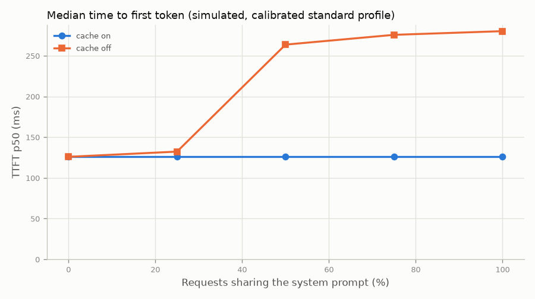
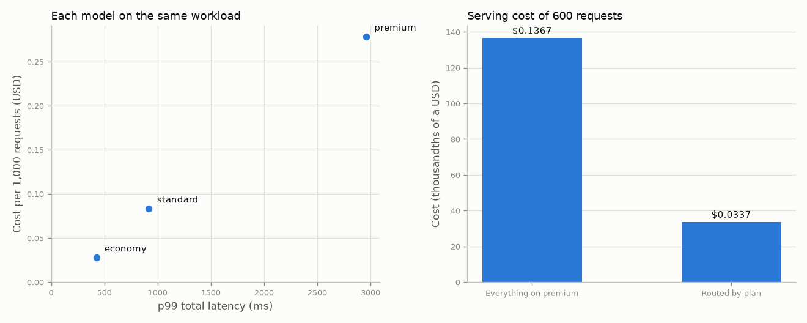
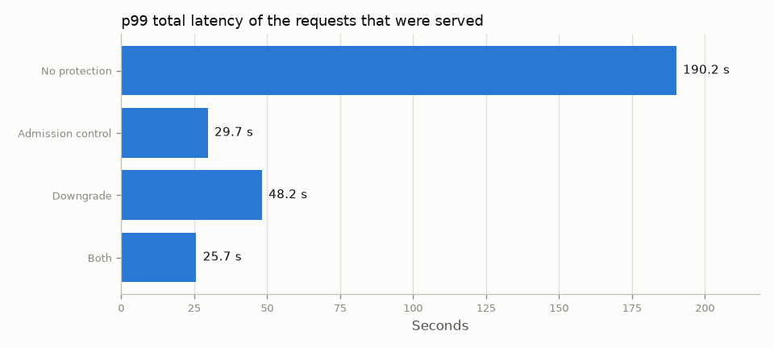
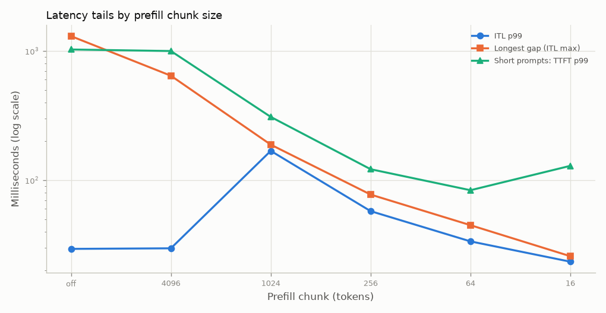
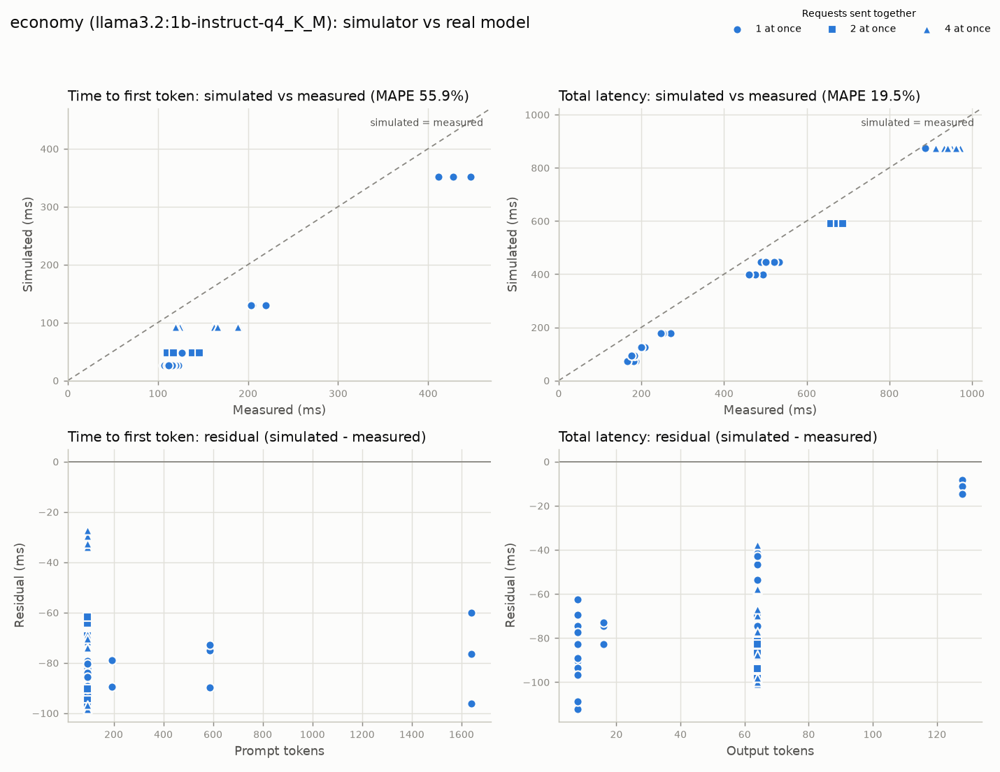
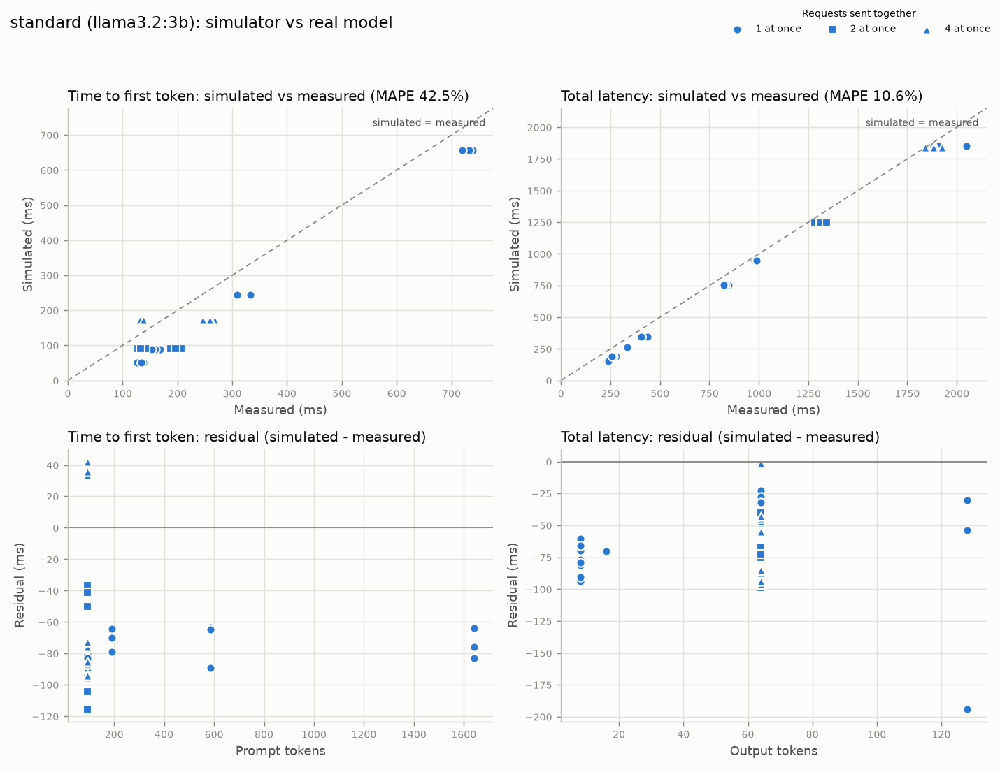

# Results report

Generated by `uv run python -m benchmarks.report` (or `make report`) from commit `691ff90`.
Do not edit by hand; change `benchmarks/report.py` and regenerate.

**Sections 1 to 5 are simulated** with seed 7 on illustrative model profiles. They are
deterministic: the same code produces the same numbers. **Section 6 is measured** on real models
and is read from files, not re-measured. Nothing here is a benchmark of real hardware except
where section 6 says so.

Times are in milliseconds unless stated. Percentiles are nearest-rank.

## 1. Baseline vs continuous batching

300 requests per run with prompts of 20 to 400 words, arriving as a
Poisson stream. "Load" is the arrival rate as a multiple of what the one-at-a-time baseline can
sustain on that model, so 1x is the baseline's limit. Both workers get identical arrivals. No
prefix cache.


| Tier | Load | Baseline req/s | Baseline p99 ms | Continuous req/s | Continuous p99 ms |
|---:|---:|---:|---:|---:|---:|
| economy | 0.5x | 0.57 | 4,560.8 | 0.57 | 1,612.0 |
| economy | 1x | 1.11 | 12,961.7 | 1.13 | 1,667.4 |
| economy | 2x | 1.18 | 121,400.4 | 2.26 | 1,748.5 |
| economy | 4x | 1.18 | 187,045.6 | 4.46 | 1,931.0 |
| economy | 8x | 1.18 | 219,868.2 | 8.70 | 2,371.9 |
| economy | 16x | 1.18 | 236,279.5 | 14.49 | 5,274.7 |
| standard | 0.5x | 0.28 | 9,142.6 | 0.28 | 3,309.6 |
| standard | 1x | 0.55 | 26,060.2 | 0.56 | 3,474.6 |
| standard | 2x | 0.58 | 244,288.9 | 1.12 | 3,742.2 |
| standard | 4x | 0.58 | 376,377.6 | 2.22 | 4,456.6 |
| standard | 8x | 0.58 | 442,421.9 | 4.26 | 7,824.2 |
| standard | 16x | 0.58 | 475,444.1 | 4.51 | 33,259.3 |
| premium | 0.5x | 0.11 | 22,951.0 | 0.11 | 8,668.8 |
| premium | 1x | 0.22 | 65,766.5 | 0.22 | 9,409.1 |
| premium | 2x | 0.23 | 617,418.5 | 0.44 | 10,826.5 |
| premium | 4x | 0.23 | 951,232.7 | 0.87 | 17,584.0 |
| premium | 8x | 0.23 | 1,118,139.9 | 1.03 | 123,162.9 |
| premium | 16x | 0.23 | 1,201,593.4 | 1.03 | 203,502.9 |

Below 1x both keep up, so throughput is just the arrival rate and the difference is in latency.
Above 1x the baseline's throughput is pinned at its capacity and its queue grows for the whole
run, so its p99 mostly reflects how long the run was. Continuous batching keeps following the
arrival rate until its own limit, which is lower for the larger models: they have smaller batch
limits and a steeper cost per extra sequence.

Reproduce this section: `uv run python -m benchmarks.report --only batching`

## 2. Prefix cache on and off

Standard tier, 300 requests at 3 req/s, each with its own 20 to 80 word prompt and 32
output tokens. A share of them also start with the same 400-word system prompt. Cost is in
thousandths of a USD (illustrative prices).



| Sharing | Off: TTFT p50 | Off: TTFT p99 | Off: cost | On: TTFT p50 | On: TTFT p99 | On: cost | Prompt tokens from cache |
|---:|---:|---:|---:|---:|---:|---:|---:|
| 0% | 23.67 | 35.84 | 10.03 | 23.67 | 35.84 | 10.03 | 0% |
| 25% | 28.41 | 157.0 | 20.46 | 23.71 | 38.77 | 10.26 | 69% |
| 50% | 79.80 | 168.3 | 29.68 | 24.00 | 38.77 | 10.24 | 81% |
| 75% | 84.39 | 228.9 | 37.37 | 23.71 | 38.77 | 10.25 | 85% |
| 100% | 88.10 | 271.4 | 46.02 | 23.71 | 87.14 | 10.50 | 88% |

With nothing shared the cache changes nothing. As more requests carry the system prompt, the
uncached run gets slower and dearer, because every one of them prefills and pays for those 400
tokens again. With the cache, time to first token and cost stay close to the no-sharing level
however many requests share the prompt. What the cache cannot remove is the cost of the first
sharers: a prefix only becomes reusable once a request carrying it has finished, so requests
that arrive before then pay in full. That is the rise in the cached p99 when everything
shares.

Reproduce this section: `uv run python -m benchmarks.report --only prefix-cache`

## 3. Cost against latency, and routing by plan

**Cost against latency.** The same 200 requests (20 to 300 word prompts, half
sharing a 200-word system prompt, 64 output tokens, 0.5 req/s) served by each model alone, with
continuous batching and the prefix cache.



| Model | Cost per 1,000 requests (USD) | p50 ms | p99 ms |
|---:|---:|---:|---:|
| economy | 0.03 | 392.9 | 424.8 |
| standard | 0.08 | 805.2 | 917.9 |
| premium | 0.28 | 2,233.7 | 2,959.7 |

This is not a trade-off curve. On these two axes the economy model is both cheapest and fastest
and the premium model is both dearest and slowest, so economy dominates. The reason to pay for a
larger model is the quality of its answers, which this simulator does not model at all. The chart
shows what quality costs, not whether it is worth it.

**Routing by plan.** 600 requests at 1 req/s from three tenants, 60% on the free
plan, 30% on pro and 10% on enterprise. Every request asks for the best model available. With
plans, "best" means the best the tenant's plan includes. Without them, everything goes to the
premium model. Serving cost is at each model's base price, before plan multipliers.

| Tenant (plan) | Requests | Routed: model | Routed: serving cost USD | Routed: p99 ms | All premium: serving cost USD | All premium: p99 ms |
|---:|---:|---:|---:|---:|---:|---:|
| initech (free) | 360 | economy | 0.00824 | 423.8 | 0.08239 | 3,435.9 |
| globex (pro) | 182 | standard | 0.01233 | 858.1 | 0.04110 | 3,458.5 |
| acme (enterprise) | 58 | premium | 0.01316 | 2,292.1 | 0.01316 | 3,549.3 |

Total serving cost is $0.03373 routed by plan against $0.13665 with
everything on premium: **75% less**. The enterprise tenant also
gets a shorter tail, because the premium model is no longer carrying the other tenants'
traffic. What the free and pro tenants give up is answer quality, which is not measured here.

Reproduce this section: `uv run python -m benchmarks.report --only cost`

## 4. Overload: admission control and downgrade

Every request asks for the premium model and opts in to downgrade. 300 arrive at
3 req/s, about three times what premium can serve, then 100 at 0.25 req/s. Admission control is a
queue limit of 16 on premium; downgrade uses a 20 s p99 SLO over a 30 s window. Latency is over
the requests that were served; rejected ones got an immediate 429.



| Protection | Served | Rejected (429) | p50 ms | p99 ms | Max ms | By premium | By standard | State changes |
|---:|---:|---:|---:|---:|---:|---:|---:|---:|
| No protection | 400 | 0 | 92,071.4 | 190,170.3 | 194,071.2 | 400 | 0 | 0 |
| Admission control | 211 | 189 | 14,710.2 | 29,655.7 | 30,904.3 | 211 | 0 | 0 |
| Downgrade | 400 | 0 | 3,433.6 | 48,214.9 | 51,611.4 | 169 | 231 | 2 |
| Both | 355 | 45 | 3,560.3 | 25,704.2 | 30,904.3 | 163 | 192 | 4 |

The two defences fail differently. Admission control bounds latency by refusing work: nothing
it serves waits behind more than a full queue, and everything else is told at once to retry.
Downgrade refuses nothing and serves the overflow on a cheaper model, but it only reacts once
slow requests have finished, so the requests already queued when it engages still wait.
Together, the queue limit caps the damage during that reaction time. "State changes" counts how
often a model switched between healthy and degraded; more than two means it switched back and
forth. Which defence is right depends on whether a refused request or a lower-quality answer is
worse for the client.

Reproduce this section: `uv run python -m benchmarks.report --only overload`

## 5. Chunked prefill

Standard tier. 400 short prompts of 20 to 80 words at
4 req/s, with 8 prompts of 6,000 to 10,000 words spread through
the run. Up to 64 output tokens. ITL is the gap between consecutive tokens of one request.



| Chunk tokens | ITL p50 | ITL p99 | ITL p99.9 | ITL max | Short TTFT p99 | Long TTFT p50 |
|---:|---:|---:|---:|---:|---:|---:|
| off | 15.00 | 29.40 | 1,063.0 | 1,303.0 | 1,027.0 | 1,075.1 |
| 4096 | 15.00 | 29.70 | 630.0 | 643.5 | 999.4 | 1,080.4 |
| 1024 | 15.00 | 168.6 | 180.8 | 188.4 | 308.9 | 1,173.7 |
| 256 | 15.00 | 57.60 | 74.10 | 77.40 | 121.6 | 1,507.2 |
| 64 | 15.60 | 33.60 | 38.55 | 44.85 | 83.63 | 2,725.0 |
| 16 | 16.20 | 23.40 | 24.60 | 25.80 | 129.1 | 5,566.7 |

Chunking removes the long stall: the longest gap falls from over a second to tens of
milliseconds, and short prompts stop waiting behind a long prompt's whole prefill. **ITL p99 is
the wrong place to look for it.** With chunking off, long prompts are rare enough that their
stalls touch fewer than 1% of gaps, so the p99 never sees them; with medium chunks each rare,
huge stall becomes many moderate ones, which do reach the p99 and make it worse. Only very small
chunks improve ITL p99, and they delay the long prompts themselves the most. The gain is in the
far tail: p99.9 and the maximum.

Reproduce this section: `uv run python -m benchmarks.report --only chunked-prefill`

## 6. Simulated against real models

These are **measurements of real models**, taken once, on one machine. They are the
only numbers in this report that are not simulated, and they are not reproduced by
`make report`: that would need the same models running on the same hardware. This section reads
the files that `benchmarks/calibrate.py` wrote.

| | |
|---|---|
| Measured at | 2026-10-07T23:58:07+00:00 |
| CPU | Intel(R) Core(TM) Ultra 7 155H (22 logical cores) |
| RAM | 15.4 GB |
| GPU | NVIDIA GeForce RTX 4060 Laptop GPU, 8188 MiB |
| OS | Windows 11 (10.0.26200) |
| Model server | ollama 0.12.6 |
| Notes | Ollama started with OLLAMA_NUM_PARALLEL=4, otherwise default settings (4096-token context). Single run. Other applications on the machine were not closed. Checked with Ollama's process list right after the run: llama3.1:8b did not fit entirely on the GPU (7.4 of 8.65 GB in VRAM), so the premium tier ran partly on the CPU; the 1B model was fully on the GPU; the 3B model was not checked. |

Fitted timing parameters, with the illustrative value the rest of this report uses in brackets,
and the simulator's error against held-out measurements (MAPE):

| Tier | Model | Prefill ms/token | Decode base ms | ms per extra sequence | Requests | TTFT error | Total latency error |
|---:|---:|---:|---:|---:|---:|---:|---:|
| economy | llama3.2:1b-instruct-q4_K_M (Q4_K_M) | 0.2099 (0.05) | 6.67 (6) | 1.91 (0.2) | 42 | 54.1% | 18.8% |
| standard | llama3.2:3b (Q4_K_M) | 0.3915 (0.15) | 14.19 (12) | 4.09 (0.6) | 42 | 42.2% | 10.5% |
| premium | llama3.1:8b (Q4_K_M) | 1.0812 (0.6) | 49.99 (30) | 15.99 (2.5) | 42 | 31.4% | 5.1% |

The tool raised no warnings about these fits.







Sections 1 to 5 use the illustrative profiles, not these fitted ones. See
`docs/13-calibration.md` for how the fit is made and where the simulator diverges from the real
servers. To measure again:

```sh
uv run python -m benchmarks.calibrate --backends <file> --out benchmarks/calibration
```

Reproduce this section: `uv run python -m benchmarks.report --only calibration`

## Limitations

- **Sections 1 to 5 are simulations.** No model runs. Timings come from a cost model with three
  parameters per model, and those parameters are illustrative: invented to give the three tiers
  different shapes, not measured. Read every figure as "how this scheduler behaves under these
  assumptions", never as the performance of Llama models or of any hardware.
- **Prices are illustrative** and so is every cost. Ratios between tiers follow from the made-up
  prices.
- **Answer quality is not modelled.** Nothing here says what a tenant loses by being served by a
  smaller model, which is the other half of every cost comparison in section 3.
- **The simulator is simplified** in ways that matter: prefill is linear in tokens and blocks the
  batch unless chunked; a decode step is linear in batch size; output length is known when a
  request is admitted; one token is one whitespace-separated word; each model has its hardware
  to itself. See the notes for steps 1, 3, 4 and 11.
- **Each result is one seed and one workload.** They are exactly reproducible, which is not the
  same as representative. Different prompt lengths, arrival patterns or mixes move the numbers.
- **Overloaded runs report the length of the run.** Where a queue never drains (the baseline
  above 1x load, "no protection" in section 4), the p99 grows with the number of requests sent.
  Compare those rows by order of magnitude only.
- **p99 over a few hundred requests is a handful of samples.** It is a nearest-rank percentile
  and can hinge on two or three requests.
- **Section 6 is one machine, once.** Real measurements are noisy and specific to that hardware,
  model build and server version. They are not re-measured when this report is regenerated.
- **Simulated and real numbers must not be compared directly.** With real models the model
  server does the batching, not this repo's scheduler (`docs/12-real-models.md`).
