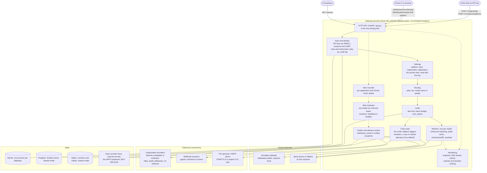

# Architecture

One gateway process, or several sharing Postgres and Valkey. Solid arrows are the request path;
dotted arrows are observation and background work. The module behind each box is in
[CLAUDE.md](../CLAUDE.md#architecture); each step's reasoning is in its numbered note
([index](README.md)).

## How to read it

- **Default mode is the simulator.** No model runs; time is simulated from a cost model fitted
  once to real models on one laptop ([note 13](13-calibration.md)). With real models the model
  server does the batching, and the gateway's scheduler, prefix cache and chunked prefill are
  not in the path ([note 12](12-real-models.md)).
- **One process or several.** By default the state is one SQLite file and one process
  ([note 21](21-persistence.md)). `GATEWAY_STATE=shared` puts the durable stores in Postgres
  and the counters in Valkey, so several instances can serve together
  ([notes 34 to 38](README.md#design-notes)).
- **Monitoring decides nothing.** No scheduling, routing or admission code reads from the
  monitor, the time series or the event bus ([note 15](15-monitoring-api.md)).
- **Everything that leaves the machine goes through one guard** ([note 32](32-provider-settings-and-vault.md),
  [note 46](46-alert-channels.md)), except mail to the operator's own SMTP server, whose host
  the operator sets ([note 48](48-email-channels.md)).
